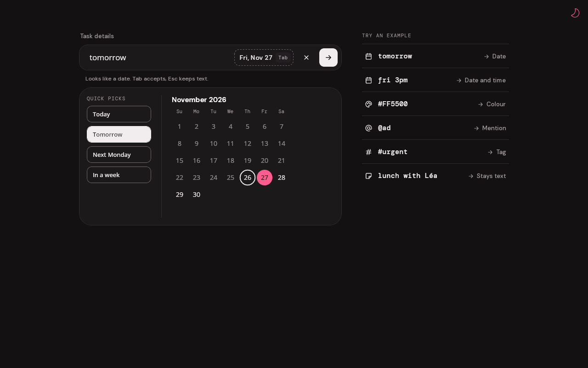
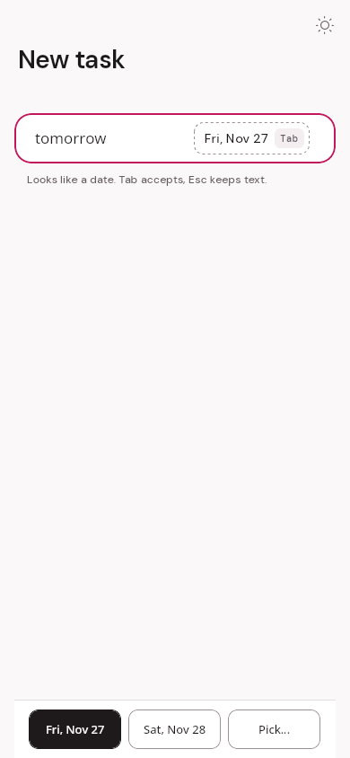

# Adaptive Input

- **Owner:** Matthew Mattei (@noknowscode)
- **Status:** ready for review
- **What it is:** A text field for Uno Platform that reads what you type as a date, a #colour, an @person or a #tag,
  suggests the value (Tab accepts, Esc keeps the text) and shows a matching picker under the field; an accepted value
  becomes a token that Backspace turns back into text. Built to the Control Gallery prototype.



## What it shows

The prototype's "Task details" field with its picker, and the examples on the right (on wide windows):

- **tomorrow**, **fri 3pm**: a dashed suggestion "Fri, Nov 27 · 3:00 PM  Tab" in the field; the picker shows quick
  picks and the month with today ringed and the date selected. Tab, the suggestion, a quick pick or a day accepts.
- **#FF5500**: a swatch, HEX and RGB, and "Use this colour".
- **@ad**: matching people; Up/Down move the active row, Enter inserts.
- **#urgent**: matching tags (an unknown tag is offered as "New tag").
- **lunch with Léa**: "Kept as plain text". **next blursday**: "That doesn’t read as a date", with "Choose a date".
- After accepting, the token sits in the field and "Backspace in the empty field" undoes it.
- On a phone (below 600 px) the suggestions ride in a bar at the bottom, above the keyboard.



## Try it

Requirements: the .NET 10 SDK. The Uno.Sdk version is pinned in `global.json` (7.0.22).

```bash
dotnet run --project AdaptiveInputDemo/AdaptiveInputDemo.csproj -f net10.0-desktop
```

Type in the field or click an example. Resize below 600 px for the phone layout. Open `AdaptiveInput.sln` for the
WebAssembly and Android heads. Set `APP_NO_HOTDESIGN=1` to run a Debug build without a DevServer.

## Design

From the Control Gallery prototype (sheet 9); what changed and what was left out is in
[`docs/PROTOTYPE-DELTA.md`](docs/PROTOTYPE-DELTA.md).

- **Typeface:** DM Sans (UI, 400/500/600) and DM Mono (labels, keys, handles, values, 400/500), bundled in
  `AdaptiveInputDemo/Assets/Fonts/` under the SIL Open Font License 1.1 (`OFL-DMSans.txt`, `OFL-DMMono.txt`). DM Sans
  ships as a variable font; Skia needs static files, so each weight is a static instance at optical size 14.
  `Styles/MaterialFontsOverride.xaml` sets DM Sans as Material's `DefaultFontFamily`; `.ttf.manifest` files map
  `FontWeight` to the files. Latin subset only (no arrow glyphs, so arrows are drawn as icons).
- **Palette** (`Styles/ColorPaletteOverride.xaml`): the prototype is dark and Dark is its palette exactly: ground
  #131112, surface #1C191B, raised #221E21, ink #F1ECEE, muted #A69DA2, hairline #322C30, outline #73686E, accent
  #FF5D8F with #131112 on it, token tint #3A1C27 with #FFD3E1 text, placeholder #7D747A, avatar #3A3337. Light is
  derived with the accent deepened to #C2185B. Body text is at least 6:1 in both themes.
- **Shapes:** field 56 px, 18 px radius, 2 px accent edge when focused; suggestion 36 px with a dashed edge and a
  "Tab" key; token 32 px, 10 px radius; picker 300 px high, 26 px radius; calendar days 34 px circles; chips and
  rows 36-40 px, 10 px radius; Tabler outline icons at 1.75 stroke.
- **Motion:** the token enters in 260 ms from 88% and 24 px to the right (`KeySpline 0.2,0.9 0.3,1`); none when the
  OS turns animations off.

## Stack

- Uno Platform single project, Uno.Sdk 7.0.22: desktop, WebAssembly and Android.
- UnoFeatures: Material, Toolkit, SkiaRenderer.
- Toolkit: `utu:Responsive`, `SystemThemeHelper`, `SafeArea` (VisibleBounds, SoftInput), Material
  `IconToggleButtonStyle` and `FilledButtonStyle`.
- The control: `Controls/AdaptiveInput/AdaptiveInputControl.cs` (+ `AdaptiveInputModels.cs`), its style, template and
  tokens in `AdaptiveInputControl.xaml` (merged from `App.xaml`); detection in `Services/InputTypeDetector.cs`.

## Usage

```xml
<controls:AdaptiveInputControl x:Name="Input"
                               Header="Task details"
                               SuggestionsPlacement="{utu:Responsive Narrowest=Accessory, Normal=Panel}"
                               TokenAccepted="OnTokenAccepted" />
```

```csharp
Input.People = new List<AdaptivePerson> { new("AM", "Ada Moreau", "ada") };
Input.Tags = new List<AdaptiveTag> { new("urgent", "12 tasks") };

void OnTokenAccepted(object? sender, AdaptiveToken token)
{
    // token.Type (Date, Color, Mention, Tag), token.Label, token.Value, token.Date, token.Time
}
```

### States

| State | How to drive it | Look (visual states) |
|---|---|---|
| Empty | `Value = ""` | `Empty`, `DatePanel` (tomorrow selected) |
| Date / date and time | `Value = "tomorrow"`, `"fri 3pm"` | `Recognised`, `Suggestion`, `DatePanel` (time note) |
| Colour | `Value = "#FF5500"` | `Recognised`, `Suggestion` + `ColourSuggestion` (swatch), `ColourPanel` |
| Mention | `Value = "@ad"` | `Recognised`, `PeoplePanel`; `NoMatches` when nobody matches |
| Tag | `Value = "#urgent"` | `Recognised`, `TagsPanel` |
| Plain | text that reads as nothing, or `Dismiss()` (Esc) | `Plain`, `PlainPanel` |
| Not recognised | text that starts like a date ("next blursday") | `NotRecognised`, `NotRecognisedPanel` ("Choose a date" opens the date panel) |
| Accepted | `Accept()` (Tab, Enter on a row, a click) | `Accepted`, `Token` or `ColourToken`, `AcceptedPanel`; `Undo()` (Backspace) reverts |
| Focused | keyboard focus in the field | `FieldFocused`: 2 px accent edge |
| Phone | `SuggestionsPlacement = Accessory`; `IsPickerOpen` for "Pick…" | `AccessoryPlacement` / `AccessoryPickerOpen` |

`State` (`AdaptiveInputState`) and `DetectedType` report the current state; `StatusText` is announced politely.

### AdaptiveInputControl

| Member | Type | Default | Description |
|---|---|---|---|
| `Value` | `string` | `""` | The text |
| `Header` | `string` | `""` | The field's label |
| `Placeholder` | `string` | "Type a date, #colour, @person or #tag" | |
| `People` | `IList<AdaptivePerson>` | five sample people | Offered for @mentions |
| `Tags` | `IList<AdaptiveTag>` | four sample tags | Offered for #tags |
| `ReferenceDate` | `DateTime?` | `null` (today) | "Today" for relative dates |
| `SuggestionsPlacement` | `SuggestionsPlacement` | `Panel` | `Panel` or `Accessory` |
| `IsPickerOpen` | `bool` | `false` | Opens the picker above the accessory bar |
| `State`, `DetectedType`, `AcceptedToken` | read-only | | Where the control is |
| `SuggestionText`, `StatusText`, `TokenText`, `Rows`, `Days`, `QuickPicks`, `AccessoryItems`... | read-only | | What the template shows |
| `Accept()`, `Dismiss()`, `Undo()`, `Clear()`, `FocusField()` | methods | | |
| `TokenAccepted`, `Submitted` | events | | A value was accepted; the add button or Enter on plain text |

**API changes in the prototype pass:** the control is a templated `Control` (was a `UserControl` with picker
`UserControl`s); `DetectedInputType` lost `NumberRange`, `Url` and `Email`; `InputTypeDetector` is static with
`Detect(text, today)`, `LooksLikeDate`, `ParseDate`, `FormatDate`; added `Header`, `People`, `Tags`,
`ReferenceDate`, `SuggestionsPlacement`, `IsPickerOpen`, `State`, `AcceptedToken`, `Accept`/`Dismiss`/`Undo`/`Clear`,
`TokenAccepted`, `Submitted`; removed the picker panels (`DatePickerPanel`, `ColorPickerPanel`, `MentionPickerPanel`,
`TagPickerPanel`, `RangePickerPanel`) and the type badge colours.

### Lightweight styling

In `AdaptiveInputControl.xaml`: per theme `AdaptiveInputPlaceholderBrush`, `AdaptiveInputAvatarBrush`,
`AdaptiveInputSwatchEdgeBrush`; shared `AdaptiveInputMonoFontFamily`, `AdaptiveInputFieldHeight`,
`AdaptiveInputFieldCornerRadius`, `AdaptiveInputPanelHeight`, `AdaptiveInputPanelCornerRadius`, and the part styles
(`AdaptiveChoiceButtonStyle`, `AdaptiveRowButtonStyle`, `AdaptiveDayButtonStyle`, `AdaptiveSuggestionButtonStyle`...).
Everything else aliases palette roles (Primary, PrimaryContainer, Surface, SurfaceVariant, OnSurface,
OnSurfaceVariant, Outline, OutlineVariant).

## Themes

- The app starts in Dark, the design's: `App.xaml.cs` calls `SystemThemeHelper.SetRootTheme(rootFrame, darkMode:
  true)` once; `App.xaml` sets no `RequestedTheme`, so the theme can change at runtime.
- The page's switch calls `SystemThemeHelper.SetRootTheme(App.ThemeRoot ?? this, isDark)`, the hosted-safe API.
- The control uses `ThemeResource` brushes only (no code lookups), so it repaints live.

## Responsive

Toolkit `{utu:Responsive}`, default breakpoints. Below Normal (600 px): "New task" heading, no field label, the
control fills the height with the suggestion bar at the bottom (`SuggestionsPlacement="Accessory"`) and the page's
`SafeArea` lifts it above the soft keyboard. From Widest (1080 px) the examples sit beside the field. Checked at
390×844, 800×1000, 1280×800 and 1920×1080.

## Hot Design previews

`AdaptiveInputDemo/HotDesignPreviews/` (Debug only), one per state, each with `ReferenceDate` = 2026-11-25 as on the
sheet:

| Preview | State |
|---|---|
| `InputEmptyPreview` | Empty: the date panel |
| `InputDatePreview` | Date: tomorrow |
| `InputDateTimePreview` | Date and time: fri 3pm |
| `InputColorPreview` | Colour |
| `InputMentionPreview` | Mention |
| `InputTagPreview` | Tag |
| `InputPlainPreview` | Plain text |
| `InputNotRecognisedPreview` | Not recognised |
| `InputAcceptedPreview` | Accepted token (accepts on load) |
| `InputAccessoryPreview` | Phone suggestion bar |

## Project structure

```
AdaptiveInputDemo/
  Controls/AdaptiveInput/   AdaptiveInputControl.cs, AdaptiveInputModels.cs, AdaptiveInputControl.xaml
  Services/                 InputTypeDetector.cs (dates, colours, people, tags)
  Presentation/             MainPage.xaml(.cs): the field and the examples
  Styles/                   ColorPaletteOverride.xaml, MaterialFontsOverride.xaml
  Assets/Fonts/             DM Sans, DM Mono, manifests, OFL licences
  HotDesignPreviews/        one preview per state (Debug only)
docs/                       the original spec and brief, PROTOTYPE-DELTA.md
```

## Staging and audit notes

**Verification pass (2026-11-26, latest):** the Android head now builds on Uno Platform 7 with 0 warnings: `Main.Android.cs` and `MainActivity.Android.cs` use the Uno 7 entry point (`Uno.UI.Runtime.Android`, host built in `CreateHost`); on Uno.Sdk 7.0.22 the old one did not compile. Android has not been run on a device or emulator. Desktop, WebAssembly and Android build with 0 warnings. The desktop app was driven through the App MCP on Windows 11 with a GPU: every check in the test plan passed, in Dark and Light. The keys (Tab accepts, Backspace in the empty field restores the text, Up / Down / Enter in the people list, Esc keeps the text) were sent as real Win32 key messages, because the App MCP's key presses do not reach `PreviewKeyDown`. Earlier notes below that say the Android head was not built are superseded.

**Prototype pass (Control Gallery sheet 9):** the control was rebuilt to the prototype (see Design, States and
`docs/PROTOTYPE-DELTA.md`): a templated `Control` with its look in `Controls/AdaptiveInput/AdaptiveInputControl.xaml`;
detection reduced to the prototype's dates, #colours, @people and #tags, with the prototype's rules (number ranges,
URLs, e-mail and colour keywords removed, and with them the range, HSV colour and old date/mention/tag picker
panels); tokens with Tab, Esc and Backspace undo; a fixed-height picker; an accessory bar for phones; DM Sans and
DM Mono bundled; the prototype's palette as Dark, Light derived. The page became the prototype's field plus its
example list. Previews redone one per state. Found on the way: on Skia the TextBox applies Backspace even after a
handled `PreviewKeyDown`, so the undo runs on the next dispatcher turn.
Verified: desktop and WebAssembly, Release and Debug, 0 warnings; Release desktop at 390×844, 800×1000, 1280×800 and
1920×1080 in Dark and Light, with XTest input: Tab accepted "tomorrow" (token, Accepted panel), Backspace restored
"tomorrow", Esc kept text, `#u` + Down + Enter inserted `#uno-7`, `@ad` Down moved the active row, `#FF5500` showed the
swatch, "next blursday" showed the Not recognised panel, "lunch with Léa" stayed plain, fri 3pm read as Fri · 3:00 PM;
the theme switch was clicked live; each preview was hosted temporarily in Debug in Dark and Light (host removed).
Side-by-side with the prototype: `compare-adaptive-input.png` in the review scratchpad. Not verified: Android,
WebAssembly at runtime, a real soft keyboard (the accessory bar relies on `SafeArea` SoftInput), Hot Design itself.

**Earlier passes** (the previous control, before the prototype):

Staged from `noknowscode/uno-lab` (`AdaptiveInput/`), then audited (uno-audit) and made ready for review.

**Staging (first pass):** the source nested the app one level deeper with two solutions, two sets of `Directory.*`
files and two `global.json` files (6.5.33 and 7.0.22); it is flattened to one solution on 7.0.22, and the spec and
brief moved to `docs/`. The unused template scaffolding (Hosting, MVUX, Navigation, Kiota HTTP, Configuration,
Localization, Serialization, ThemeService, Dsp, `SecondPage`, `Shell`, appsettings) and the iOS/Windows files were
removed. The dark-only palette got a Light version (all 33 roles in both), the badge accents moved to App.xaml, and
the page went into a ScrollViewer.

**Audit and readiness pass:**

- Theme lookups: the control and the colour, tag and date pickers read brushes from `Application.Current.Resources`,
  which follows the app's theme, not the element's, so with an element-level theme switch they would show the wrong
  palette. They now use `ThemeResource` probes or Material styles and refresh on `ActualThemeChanged` (the pickers
  rebuild their items, which is cheap: at most 20 swatches or 10 tags).
- Themes: `RequestedTheme="Dark"` removed from `App.xaml`; Dark is applied once at startup through `SystemThemeHelper`
  and a switch on the page changes it at runtime.
- Range picker: at 390 px the presets and Apply did not fit; Apply now moves under the presets on phones. The range
  bar's fill was sized before layout (track width 0) and never updated, so it never showed; it now follows the
  track's `SizeChanged`.
- Date picker: the quick-pick buttons were clipped at 390 px; they now share the width in three columns.
- Responsive: the `AdaptiveTrigger` (640 px) became `utu:Responsive` (Normal, 600 px).
- Contrast: white text on the light badge accents was 1.6-2.8:1; badges now pick near-black or white by luminance.
  Dark `OnSurfaceVariant` went from `#8888A0` to `#9292AA` (the Auto badge label was 4.34:1 on SurfaceVariant).
- Cleanup: the empty `OnInputSubmitted` handler on the page, `CharacterSpacing` (a no-op on the Skia text stack).
- Debug runs without a DevServer: `UseStudio()` is skipped when `APP_NO_HOTDESIGN=1`.

**Verified here:** desktop and WebAssembly build with 0 warnings in Release and Debug; the previews are left out of
the Release assembly. The desktop app runs in Dark and Light at 1280x800 with each example (date, colour, tag,
mention, range) and at 390x844 (range, date, mention), plus 800x1000 and 1920x1080; the theme switch was clicked at
runtime, also with the tag and date pickers open; each preview was hosted temporarily in a Debug build and checked in
Dark and Light. No exceptions in the app logs.

**Not verified:** the Android head was not built here, WebAssembly was built but not run, the Studio import and Hot
Design were not tested, and typing on a soft keyboard was not tried.
