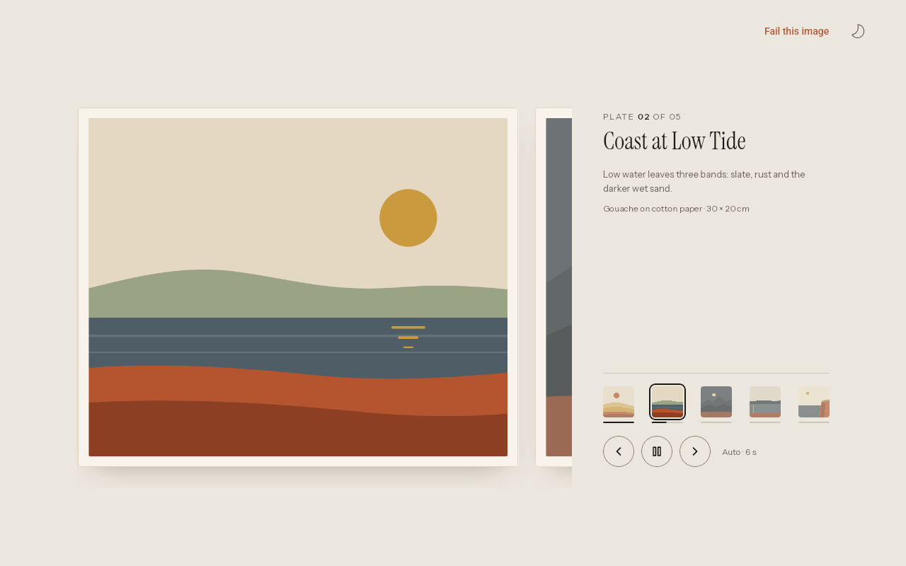

# Carousel

- **Owner:** Matthew Mattei (@noknowscode)
- **Status:** ready for review
- **What it is:** A carousel control for Uno Platform, proposed for the Uno Toolkit, styled after the Control Gallery
  "Carousel" sheet: mounted plates on a track that glides with the next plate peeking in, the caption kept off the
  image, thumbnails with auto-play progress, load states per plate, keyboard, swipe and an automation peer. The app
  is a minimal host for it.



## What it shows

One `Carousel` configured like the sheet's live figure: the five "Low Tide Series" plates, the caption beside the
track (`PLATE 02 OF 05`, title, description, medium), the thumbnail strip with progress bars and the previous / pause /
next row with its status (`Auto · 6 s`, `Held`, `Paused`). Under 720 px the control switches to its narrow layout:
header and `02 / 05` on top, the plate, the caption below and 56 × 48 thumbnails.

The host page adds only the theme switch and a "Fail this image" button, which breaks the current plate's image so
you can see the failed state; "Try again" restores it.

## Try it

Requirements: the .NET 10 SDK. The Uno.Sdk version is pinned in `global.json` (7.0.22).

```bash
dotnet run --project Carousel/Carousel.csproj -f net10.0-desktop
```

Click a plate (or tab to the carousel) and use ← → , Home, End, and Space to pause. Hover or focus holds auto-play.
Drag or swipe the plates. Open `Carousel.sln` in Visual Studio or Rider for the WebAssembly and Android heads
(`net10.0-browserwasm`, `net10.0-android`).

## Design

Taken from the Control Gallery sheet 01 "Carousel" (`docs/PROTOTYPE-DELTA.md` lists every value and what was not
adopted).

- **Typeface:** Instrument Serif 400 for titles (34 px, line height 1.06; 30 px header), Instrument Sans 400 / 500 /
  600 for the UI (13 px body, 12 px labels). Bundled in `Carousel/Assets/Fonts/` as static TTFs cut from the Google
  Fonts files (the Sans is a variable font; Skia renders a variable font at its default instance), with an
  `OFL-<Family>.txt` licence per family. Instrument Sans drives the Material type ramp through
  `Styles/MaterialFontsOverride.xaml`.
- **Palette (Light, exact):** ground `#ECE7DE`, surface `#F4EFE7`, mat `#F8F4EC`, mat ring `#DDD3C3`, ink `#1D1B18`,
  muted `#5F594F`, hairline `#CFC6B8`, control outline `#857D6E`, skeleton `#DDD4C5`, placeholder `#E4DACA`, rust
  `#B5552F` (Primary). Dark keeps the warm paper identity on `#1A1815`. Palette roles are in
  `Styles/ColorPaletteOverride.xaml`; the control's own tokens (`CarouselMatBrush`, `CarouselInkBrush`...) are in the
  Light and Default theme dictionaries of `Controls/Carousel/Carousel.xaml`.
- **Shape:** plates have a 14 px mat, radius 4, a 1 px ring and a `0 18 32 -24` shadow (`utu:ShadowContainer`);
  thumbnails 44 × 44 radius 4 with a 2 px ink ring on the current one; 44 px round outlined transport buttons.
- **Motion:** the track glides 700 ms on KeySpline `0.22,1 0.36,1` (CSS `cubic-bezier(.22,1,.36,1)`), plate opacity on
  the same curve; captions cross-fade (old out 360 ms, new in after 160 ms with a 6 px rise over 480 ms); buttons
  press to 0.96; the loading spinner turns every 2.4 s, only while a plate is loading.

## Stack

- Uno Platform single project, Uno.Sdk 7.0.22: desktop, WebAssembly and Android.
- UnoFeatures: Material, Toolkit, Logging, SkiaRenderer.
- The control lives in `Carousel/Controls/Carousel/` in the `Uno.Toolkit.UI` namespace, with its default styles in
  `Carousel.xaml` (merged through `Themes/Generic.xaml`).

## Themes

The app follows the system theme. The toggle at the top right switches Light and Dark at runtime with the Toolkit's
`SystemThemeHelper.SetRootTheme` on the app's root element (`App.AppRoot`), which also works when Studio or the
Gallery hosts the page under a XamlRoot the app doesn't own.

## Responsive

The control picks its layout from its own width: beside the plates from `SidePlacementMinWidth` (720) up, below them
under it (`CaptionPlacement="Auto"`). The host page uses `{utu:Responsive}` for the rest: page padding, a 24 px peek
and 14 px gap with 56 × 48 thumbnails below `Wide` (800 px), a 52 px peek, 24 px gap and 44 px thumbnails from `Wide`
up. Checked at 390 × 844, 800 × 1000, 1280 × 800 and 1920 × 1080.

## Hot Design previews

`Carousel/HotDesignPreviews/` (compiled in Debug only), one preview per state, bound to the bundled plates:

| Preview | Shows |
|---|---|
| `CarouselPlatesPreview` | The sheet's default view: side caption, thumbnails, transport, auto-play |
| `CarouselNarrowPreview` | The 390 px layout |
| `CarouselPausedPreview` | `IsPaused="True"`: play icon and "Paused" |
| `CarouselPlateLoadingPreview` | `CarouselPlate` `State="Loading"`: spinner, skeleton caption, sizes kept |
| `CarouselPlateLongTitlePreview` | A long title clamped to two lines with an ellipsis |
| `CarouselPlateFailedPreview` | A missing image: "Image unavailable" and Try again |
| `CarouselVerticalPreview` | Overlay mode, vertical orientation |
| `CarouselFadePreview` | Overlay mode, fade transition, no looping |
| `CarouselEmptyPreview` | No items |

## States

| State | How to drive it | What it looks like |
|---|---|---|
| Plate loading | `CarouselPlate.State = Loading` (set automatically while `Source` loads) | Spinner on the placeholder, skeleton bars for the caption; mat, ratio and caption height kept |
| Plate failed | `CarouselPlate.State = Failed` (set automatically on `ImageFailed`) | "Image unavailable" (`FailedText`, announced politely) and a "Try again" button (`RetryText`) that raises `RetryRequested` and reloads; caption, position label and navigation keep working |
| Plate ready | `CarouselPlate.State = Ready` (set on `ImageOpened`) | The image |
| Long title | Any title | `CarouselTitleTextStyle` and the plate caption stop at two lines with an ellipsis |
| Playing / Held / Paused / Off | Read `Carousel.PlaybackState`; drive with `IsAutoPlayEnabled`, `IsPaused`, hover and focus | Status text `Auto · 6 s` / `Held` / `Paused`; pause or play icon; progress bar runs or stops |
| Empty | No items | Nothing to navigate; buttons disabled, no label |

## Public API

### Carousel properties

| Property | Type | Default | Description |
|---|---|---|---|
| `ItemsSource` | `object` | `null` | Items to show |
| `ItemTemplate` | `DataTemplate` | `null` | Template for each item (the sample uses a `CarouselPlate`) |
| `SelectedIndex` | `int` | `-1` | Current item (two-way bindable; a value set before the items exist is honoured) |
| `SelectedItem` | `object` | `null` | The current data item |
| `Orientation` | `Orientation` | `Horizontal` | Layout direction |
| `IsLoopingEnabled` | `bool` | `true` | Wrap from the last item to the first |
| `IsAutoPlayEnabled` | `bool` | `false` | Advance automatically |
| `AutoPlayInterval` | `TimeSpan` | `0:0:6` | Time per item |
| `IsPaused` | `bool` | `false` | Pauses auto-play (the play/pause button and Space toggle it) |
| `PlaybackState` | `CarouselPlaybackState` | `Off` | Read-only: Off, Playing, Held (pointer over or focus inside), Paused |
| `ItemPeek` | `double` | `0` | How much of the next item shows; above 0 (or with a spacing) the carousel is in track mode |
| `ItemSpacing` | `double` | `0` | Gap between items in track mode |
| `InactiveItemOpacity` | `double` | `1` (style: `0.72`) | Opacity of the other items in track mode |
| `ItemTransition` | `ICarouselTransition` | `SlideTransition` | Transition in overlay mode (no peek, no spacing) |
| `ThumbnailTemplate` | `DataTemplate` | `null` | When set, a thumbnail strip with progress bars replaces the dots |
| `ThumbnailStyle` | `Style` | `CarouselThumbnailButtonStyle` | Style of each `CarouselThumbnail` |
| `ThumbnailWidth` / `ThumbnailHeight` | `double` | `44` / `44` | Thumbnail image size |
| `CaptionTemplate` | `DataTemplate` | `null` | Caption of the selected item, cross-faded |
| `CaptionPlacement` | `CarouselCaptionPlacement` | `Auto` | `Side`, `Bottom`, or `Auto` from the control's width |
| `SidePlacementMinWidth` | `double` | `720` | Width from which `Auto` puts the caption beside the items |
| `Header` | `object` | `null` | Title above the items in the bottom layout |
| `ItemLabel` | `string` | `"Item"` | Noun for the position label and accessible names ("Plate") |
| `TransportVisibility` | `Visibility` | `Visible` | The previous / play-pause / next row in the side layout |
| `IndicatorVisibility` | `Visibility` | `Visible` | The dots (shown when there is no thumbnail template) |
| `IndicatorStyle` | `Style` | `null` | Kept for compatibility; not used by the template |

Events: `SelectionChanged`, `SelectionChanging` (set `Cancel = true` to prevent). Methods: `Next()`, `Previous()`,
`GoTo(int index, bool animate = true)`.

### CarouselPlate

| Member | Type | Description |
|---|---|---|
| `Source` | `ImageSource` | The image; setting it starts Loading |
| `State` | `CarouselPlateState` | Ready, Loading, Failed |
| `Title` / `Subtitle` | `string` | Optional caption under the mat (title clamps at two lines) |
| `FailedText` / `RetryText` | `string` | "Image unavailable" / "Try again" |
| `Padding` | `Thickness` | Mat width (14 by default) |
| `RetryRequested` | event | Raised by Try again, before the plate reloads |
| `Reload()` | method | Loads `Source` again |

### Caption styles

`CarouselTitleTextStyle`, `CarouselHeaderTextStyle`, `CarouselBodyTextStyle`, `CarouselMetaTextStyle`,
`CarouselLabelTextStyle`, and the fonts `CarouselDisplayFontFamily` and `CarouselStrongFontFamily`, for caption
templates.

### API changes in the prototype pass

- `AutoPlayInterval` is now `TimeSpan` (was `TimeSpan?`), default 6 s, so it can be set in XAML.
- New: `ItemPeek`, `ItemSpacing`, `InactiveItemOpacity`, `ThumbnailTemplate`, `ThumbnailStyle`, `ThumbnailWidth`,
  `ThumbnailHeight`, `CaptionTemplate`, `CaptionPlacement`, `SidePlacementMinWidth`, `Header`, `ItemLabel`,
  `TransportVisibility`, `IsPaused`, `PlaybackState`; types `CarouselPlate`, `CarouselPlateState`,
  `CarouselThumbnail`, `CarouselThumbnailPanel`, `CarouselCaptionPlacement`, `CarouselPlaybackState`.
- The previous / next buttons moved from the item overlay into the transport row (same part names).
- Auto-play no longer stops for good on hover: it holds and resumes with the remaining time.

## XAML usage

```xml
<utu:Carousel ItemsSource="{Binding Plates}"
              Header="Low Tide Series"
              ItemLabel="Plate"
              IsAutoPlayEnabled="True"
              ItemPeek="52"
              ItemSpacing="24">
  <utu:Carousel.ItemTemplate>
    <DataTemplate>
      <utu:CarouselPlate Source="{Binding Image}" />
    </DataTemplate>
  </utu:Carousel.ItemTemplate>
  <utu:Carousel.ThumbnailTemplate>
    <DataTemplate>
      <Image Source="{Binding Thumbnail}" Stretch="UniformToFill" />
    </DataTemplate>
  </utu:Carousel.ThumbnailTemplate>
  <utu:Carousel.CaptionTemplate>
    <DataTemplate>
      <StackPanel Spacing="12">
        <TextBlock Text="{Binding Title}" Style="{StaticResource CarouselTitleTextStyle}" />
        <TextBlock Text="{Binding Description}" Style="{StaticResource CarouselBodyTextStyle}" />
      </StackPanel>
    </DataTemplate>
  </utu:Carousel.CaptionTemplate>
</utu:Carousel>
```

## Project structure

```
Carousel/Controls/Carousel/
  Carousel.cs               navigation, track and overlay modes, swipe, auto-play, caption, placement, keyboard
  Carousel.Properties.cs    dependency properties and the placement / playback enums
  Carousel.Events.cs        event args and events
  Carousel.xaml             tokens, fonts, caption styles, and the Carousel / CarouselPlate / thumbnail templates
  CarouselPanel.cs          overlay (items at 0,0) or track (items in a row) layout
  CarouselPlate.cs          mounted image with Ready / Loading / Failed states
  CarouselThumbnail.cs      thumbnail button with a progress fill
  CarouselThumbnailPanel.cs space-between row of thumbnails
  CarouselIndicator.cs      dots
  CarouselAutomationPeer.cs accessibility
  ICarouselTransition.cs, CarouselTransitionBase.cs, SlideTransition.cs, FadeTransition.cs   overlay transitions
tools/plates/*.svg, tools/render_plates.js   the sheet's plate SVGs and the Playwright script that renders the PNGs
```

## Staging and audit notes

**Verification pass (2026-11-26, latest):** the Android head now builds on Uno Platform 7 with 0 warnings: `Main.Android.cs` and `MainActivity.Android.cs` use the Uno 7 entry point (`Uno.UI.Runtime.Android`, host built in `CreateHost`); on Uno.Sdk 7.0.22 the old one did not compile. Android has not been run on a device or emulator. Desktop, WebAssembly and Android build with 0 warnings. The desktop app was driven through the App MCP on Windows 11 with a GPU: every check in the test plan passed: keys, auto-play and hover hold, thumbnails, the failed image and Try again, Dark and Light; no exceptions or binding errors. Earlier notes below that say the Android head was not built are superseded.

Staged from `noknowscode/uno-lab` (`Carousel/`) and audited earlier (see git history for those notes: bundled
images, Light/Dark palette, theme-aware indicator brushes, the vertical slide fix, the reload-safe swipe handlers, the
automation peer count, Hot Design previews, `{utu:Responsive}`).

Prototype pass (this change): the control was brought in line with the Control Gallery "Carousel" sheet. The look
moved into the control (track mode, plates, caption, thumbnails, transport, tokens, fonts); `CarouselPlate` adds the
sheet's Loading and Image failed states; auto-play holds on hover and focus and Space pauses; the demo page became a
minimal host; the photo gallery, its generated photos and `tools/make_photos.py` were removed and replaced by the
sheet's five plates; the palette, icon and splash moved to the sheet's colours (rust `#B5552F` ground).

Verified here: desktop (Release and Debug) and WebAssembly (Release and Debug) build with 0 warnings; the desktop app
runs with no exceptions in its log, checked in Light and Dark (switching at runtime) at 390 × 844, 800 × 1000,
1280 × 800 and 1920 × 1080; next, End, Right and Space were driven with synthesized input (track glide mid-frame,
caption cross-fade, Held / Paused status); the failed state was triggered and the theme switched with it showing;
each Hot Design preview was hosted temporarily in a Debug build and checked in Light and Dark. Not verified: Android
and iOS were not built here, the WebAssembly build was not run, Hot Design and the Studio import were not opened, and
a touch swipe could not be synthesized headless (the manipulation path is shared with mouse drag, not exercised
either).
