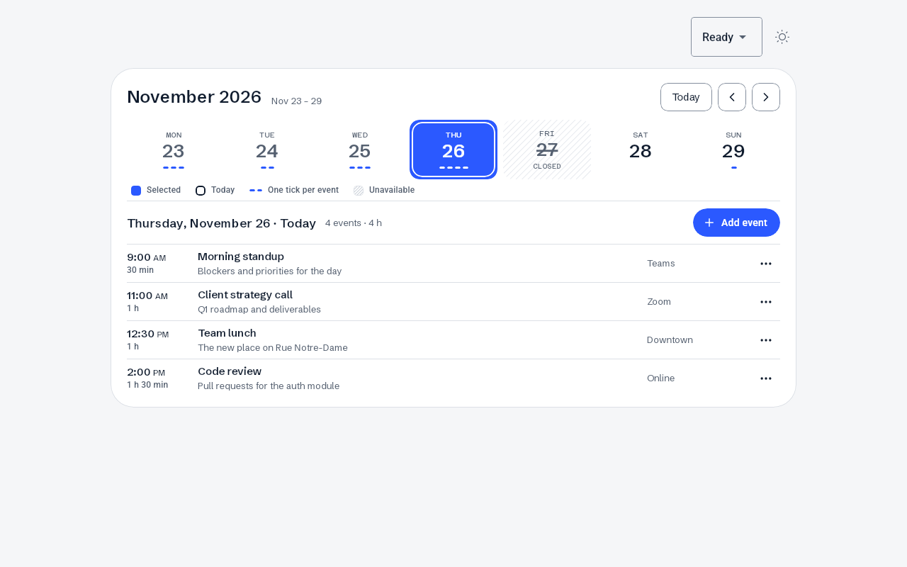

# Horizontal Calendar

- **Owner:** Matthew Mattei (@noknowscode)
- **Status:** ready for review
- **What it is:** A week-strip calendar control (`HorizontalCalendar`) for Uno Platform, styled after the Control
  Gallery "Horizontal Calendar" sheet: a week of days with a sliding selection pill, one tick per event, hatched
  unavailable days, and the selected day's agenda with empty, loading and error states. The app is a minimal host.



## What it shows

One `HorizontalCalendar` configured like the sheet's live figure: this week, today selected, Friday closed ("Office
closed"), next Tuesday booked out, the sheet's events (standup, client strategy call, team lunch, code review...)
anchored to the current week, and three weeks you can page through. Under 600 px the control switches to its phone
layout: month name and range stacked, 44 px week buttons, 66 px days, location under each title and a docked
"Add event" button.

The host page adds only an agenda-state picker (Ready, Loading, Error) and the theme switch. "Add event" adds a
one-hour event at the first free hour; "More options" on a row offers Delete; Retry in the error state simulates a
reload.

## Try it

Requirements: the .NET 10 SDK. The Uno.Sdk version is pinned in `global.json` (7.0.22).

```bash
dotnet run --project HorizontalCalendar/HorizontalCalendar.csproj -f net10.0-desktop
```

A Debug build waits for the Uno DevServer (Hot Design); from a plain terminal, add `-c Release` or set
`APP_NO_HOTDESIGN=1`.

Click a day, page the week with the arrows, or focus a day and use ← → (days), PgUp / PgDn (weeks) and T (today).
Open `HorizontalCalendar.sln` in Visual Studio or Rider for the WebAssembly and Android heads.

## Design

Taken from the Control Gallery sheet 02 "Horizontal Calendar" (`docs/PROTOTYPE-DELTA.md` lists every value and what
was not adopted).

- **Typeface:** Schibsted Grotesk 400 / 500 / 600 (month 24 px, day numbers 26 px, agenda day 17 px, rows 15 / 13 px)
  and Azeret Mono 400 / 500 (weekday labels 11 px, "CLOSED"). Bundled in `HorizontalCalendar/Assets/Fonts/` as static
  TTFs cut from the Google Fonts variable files (Skia renders a variable font at its default instance), with an
  `OFL-<Family>.txt` licence per family. Schibsted Grotesk drives the Material type ramp through
  `Styles/MaterialFontsOverride.xaml`.
- **Palette (Light, exact):** ground `#F5F6F8`, card `#FFFFFF`, navy ink `#0F1B2D`, muted `#556070`, hairline
  `#DCE0E6`, outline `#848E9D`, skeleton `#E8EBF0`, hover `#EEF1F5`, hatch `#E6E9EE`, cobalt `#2B59FF` (Primary) with
  white text (5.3:1). Dark: ground `#0B111B`, card `#121A27`, ink `#E8EDF5`, muted `#9AA6B8`, same cobalt. Material
  roles are in `Styles/ColorPaletteOverride.xaml`; the control's tokens are in the Light and Default theme
  dictionaries of `Controls/HorizontalCalendar/HorizontalCalendar.xaml`.
- **Shape:** card radius 32 with a hairline; days 84 px, radius 14; ticks 8 × 3 px; buttons radius 10 (40 px), "Add
  event" a 40 px pill; rows 54 px with a top hairline (64 px on phones).
- **Motion:** pill 380 ms, week slide 460 ms, both KeySpline `0.3,0.7 0.2,1` (CSS `cubic-bezier(.3,.7,.2,1)`); the
  agenda fades in over 220 ms and rises 6 px over 320 ms, 80 ms after a day change; buttons press to 0.96.

## States

| State | How to drive it | What it looks like |
|---|---|---|
| Selected | `SelectedDate` (two-way), click, keys | Cobalt pill, white text and ticks; the pill slides from the previous day |
| Today | `Today` (defaults to the current date) | 1.5 px navy ring; a white ring 3 px in when it is also selected |
| Busy | `EventsProvider` | One tick per event, up to four |
| Past | days before `Today` | Muted day number |
| Unavailable | `UnavailableDays` (date → `CalendarUnavailableDay(Label, Reason)`) | Hatched, number struck through, "CLOSED" / "FULL"; focusable (named "..., Office closed, not bookable", tooltip with the reason) but never selected; keys skip it |
| Empty day | `AgendaState = Ready` and no events | "Nothing on Saturday", "The day is open. Add an event or pick another day." and an outline "Add event"; the agenda keeps its height |
| Loading | `AgendaState = Loading` | Ticks hidden, three skeleton rows at the rows' height; dates stay usable |
| Load error | `AgendaState = Error` (`ErrorTitle`, `ErrorMessage`) | Only the agenda is replaced: "Events didn’t load", "Your selected day is kept.", Retry (raises `RetryRequested`); the title is announced (assertive) |
| Phone | `DisplayMode` (Auto under `CompactMaxWidth` = 600) | The Fig. 3 layout |

## Public API

| Member | Type | Description |
|---|---|---|
| `SelectedDate` | `DateTime` | Selected day (two-way); unavailable or out-of-range days are refused |
| `Today` | `DateTime` | Day with the today ring; defaults to `DateTime.Today` |
| `MinDate` / `MaxDate` | `DateTime?` | Selectable range; paging stops at their weeks |
| `UnavailableDays` | `IReadOnlyDictionary<DateTime, CalendarUnavailableDay>` | Days that can't be booked |
| `AgendaState` | `CalendarAgendaState` | Ready, Loading, Error |
| `ErrorTitle` / `ErrorMessage` | `string` | Error texts |
| `DisplayMode` | `CalendarDisplayMode` | Auto, Regular, Compact |
| `CompactMaxWidth` | `double` | Width under which Auto is compact (600) |
| `LegendVisibility` | `Visibility` | The legend under the strip (regular layout) |
| `EventsProvider` | `Func<DateTime, DateTime, IEnumerable<CalendarEvent>>` | Events between two days, called for the shown week and its neighbours |
| `WeekStart`, `SelectedDayEvents` | read-only | The shown Monday; the selected day's events |
| `RefreshEvents()`, `GoToToday()`, `SelectDate(DateTime)`, `PreviousWeek()`, `NextWeek()` | methods | |
| `SelectedDateChanged` | `EventHandler<DateTime>` | A day was selected |
| `AddEventRequested` | `EventHandler` | An "Add event" button was pressed |
| `RetryRequested` | `EventHandler` | Retry in the error state |
| `EventOptionsRequested` | `EventHandler<CalendarEventOptionsRequestedEventArgs>` | A row's "More options" (`Event`, `Target` for a flyout) |

`CalendarEvent` carries `Id`, `Title`, `Description`, `Location`, `StartTime` and `EndTime` ("Teams", "Zoom",
"Online" and "Meet" get a video icon on phones, other places a pin).

```xml
<controls:HorizontalCalendar x:Name="Calendar"
                             AutomationProperties.Name="Calendar"
                             AddEventRequested="OnAddEventRequested"
                             RetryRequested="OnRetryRequested" />
```

```csharp
Calendar.UnavailableDays = new Dictionary<DateTime, CalendarUnavailableDay> { [friday] = new("Closed", "Office closed") };
Calendar.EventsProvider = (start, end) => events.Where(e => e.StartTime.Date >= start && e.StartTime.Date <= end);
Calendar.RefreshEvents();
```

### API changes in the prototype pass

The control was rebuilt from a month-strip `UserControl` into a templated week-strip `Control`:

- Removed: `DateSelected` (`EventHandler<CalendarDate>`; use `SelectedDateChanged`), `AddEvent`, `RemoveEvent`
  (change your data and call `RefreshEvents`), the `CalendarDate` model, `CalendarEvent.Category`, `ColorHex` and
  `IsAllDay`, the converters and `Styles/CalendarResources.xaml`.
- Added: `SelectedDate`, `Today`, `MinDate`, `MaxDate`, `UnavailableDays`, `AgendaState`, `ErrorTitle`,
  `ErrorMessage`, `DisplayMode`, `CompactMaxWidth`, `LegendVisibility`, `WeekStart`, `SelectedDayEvents`,
  `PreviousWeek()`, `NextWeek()`, `SelectedDateChanged`, `RetryRequested`, `EventOptionsRequested`; types
  `CalendarDayButton`, `CalendarWeekPanel`, `CalendarAgendaState`, `CalendarDisplayMode`, `CalendarAgendaItem`,
  `CalendarEventOptionsRequestedEventArgs`, `CalendarUnavailableDay`.
- The agenda is part of the control now (the page used to list the events).

## Themes

The app follows the system theme (the sheet is light; the old forced Dark start was removed). The switch at the top
right calls `SystemThemeHelper.SetRootTheme(App.ThemeRoot ?? this, isDark)`, which also works when Studio or the
Gallery hosts the page.

## Responsive

The control picks its layout from its own width (`DisplayMode="Auto"`, compact under 600 px). The page uses
`{utu:Responsive}` for its padding and for the card's height (fills the window below `Wide`, at most 520 px from
`Wide` up). Checked at 390 × 844, 800 × 1000, 1280 × 800 and 1920 × 1080.

## Hot Design previews

In `HorizontalCalendar/HotDesignPreviews/` (Debug builds only), each configured with the sample data by
`PreviewData.Configure`:

| Preview | Shows |
|---|---|
| `CalendarWeekPreview` | The default view: this week, ticks, closed Friday, the day's agenda |
| `CalendarCompactPreview` | The 390 px phone layout |
| `CalendarEmptyDayPreview` | Saturday selected: the empty-day state |
| `CalendarLoadingPreview` | `AgendaState="Loading"` |
| `CalendarErrorPreview` | `AgendaState="Error"` |

## Project structure

```
HorizontalCalendar/
  App.xaml(.cs)                         window, Frame, Material theme, ThemeRoot
  MainPage.xaml(.cs)                    host: the calendar, agenda-state picker, theme switch
  Controls/HorizontalCalendar/          the control: HorizontalCalendar(.Properties).cs, CalendarDayButton.cs,
                                        CalendarWeekPanel.cs, CalendarTypes.cs, HorizontalCalendar.xaml
  Models/CalendarEvent.cs, SampleEvents.cs
  HotDesignPreviews/                    Hot Design previews (Debug only)
  Styles/ColorPaletteOverride.xaml, MaterialFontsOverride.xaml
  Themes/Generic.xaml                   merges the control's dictionary
  Assets/Fonts/                         Schibsted Grotesk, Azeret Mono, OFL files
```

## Staging and audit notes

**Verification pass (2026-11-26, latest):** the Android head now builds on Uno Platform 7 with 0 warnings: `Main.Android.cs` and `MainActivity.Android.cs` use the Uno 7 entry point (`Uno.UI.Runtime.Android`, host built in `CreateHost`); on Uno.Sdk 7.0.22 the old one did not compile. Android has not been run on a device or emulator. Desktop, WebAssembly and Android build with 0 warnings. The desktop app was driven through the App MCP on Windows 11 with a GPU: every check in the test plan passed in Debug, including the 1280x800 window. The Release desktop build was also launched at a 1280x800 client area on the GPU: the whole calendar renders (week strip, selection pill, agenda rows, card), with 2.1 % near-black pixels, all of them the window frame. The black window described below is specific to Mesa software OpenGL, and the blocking check is done. Earlier notes below that say the Android head was not built are superseded.

Staged from `noknowscode/uno-lab` (`HorizontalCalendar/`), audited (uno-audit) and made ready except for the renderer
check below; see the git history for those notes.

**Prototype pass (this change):** the control was rebuilt after the Control Gallery sheet: a templated week strip
with the sheet's pill, ticks, today ring and unavailable days, the agenda moved into the control with its four
states, keyboard paging, the phone layout, the sheet's palette and bundled fonts (DM Sans / Instrument Serif are no
longer used, so the old "fonts not available offline" fallback is gone), the sheet's sample data, a minimal host page
and new previews. Icon and splash moved to the cobalt `#2B59FF`.

**Verified here:** desktop and WebAssembly build with 0 warnings in Release and Debug. The desktop app (software
backend, see below) runs in Light and Dark at 390 × 844, 800 × 1000, 1280 × 800 and 1920 × 1080 with no exceptions in
its log; the theme switch, a day click (pill mid-slide captured), → , PgDn, T, the week buttons (strip mid-slide
captured; next stops at `MaxDate`) were driven with synthesized input; each preview was hosted temporarily in a Debug
build and checked in Light and Dark.

**Not verified:** the Android head was not built here (no workload), WebAssembly was built but not run, the Studio
import and Hot Design were not tested, and the default OpenGL backend on real hardware (below).

**Known renderer issue (Xvfb with Mesa software OpenGL only):** with the default OpenGL backend, the Release desktop
build paints the window almost black at some sizes (1280x800 here); only the agenda rows clipped by the viewport are
drawn. The earlier bisection (on the old template) found the trigger to be content with a rounded corner cut by a
scrolling viewport's edge; it still reproduces with the new template (rounded card, agenda `ScrollViewer`). The Skia
software backend (`.UseX11(x => x.ForceRenderingBackend(X11RenderingBackend.Software))`) renders every size
correctly, so the screenshots were taken with that line in a temporary edit of `Platforms/Desktop/Program.cs`
(reverted). The app code is not changed for this: it looks like a Skia OpenGL clip issue on llvmpipe, and still needs
a check on a machine with a GPU. **Checked 2026-11-26:** it renders on a GPU (see the verification pass above), so
the issue is limited to Mesa software OpenGL; worth reporting to the Uno Platform team with the Xvfb repro.
