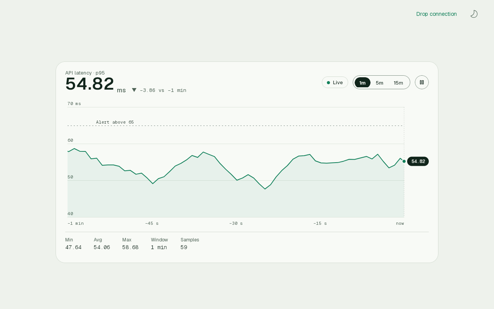

# Liveline

- **Owner:** Matthew Mattei (@noknowscode)
- **Status:** ready for review
- **What it is:** `LivelineChart`, a live metric card control for Uno Platform: the latest value and its change, a
  stream status, a 1 / 5 / 15 min window, pause, a SkiaSharp line chart that glides between samples, inspection, and
  the window's min, avg and max. The app feeds it a simulated API latency stream.



## What it shows

- **Header:** "API latency · p95", the value (44 px) with its unit and change against the window's start
  (▼ −1.17 vs −1 min), a Live chip, the window selector and a pause button.
- **Chart:** a fixed 40–70 axis with grid labels, a dashed alert line at 65, a straight 2 px line over a 7% area, a
  dashed "now" line, the live dot and a value tag. One sample a second; the line glides between samples.
- **Inspect:** hover, or Tab to the chart and use ← → (Home / End); Esc closes. A crosshair and a tooltip show the value
  and how long ago.
- **States:** Connecting, Live, Pausing, Paused (shows the time), Disconnected (hatched gap, Reconnect).
- **Phone:** below 560 px of card width the controls move under the chart and the stats keep Min / Avg / Max.

## Try it

Requirements: the .NET 10 SDK. The Uno.Sdk version is pinned in `global.json` (7.0.22).

```bash
dotnet run --project Liveline/Liveline.csproj -f net10.0-desktop
```

The card connects for two seconds, then goes live. Hover the line, pause, switch the window, or press **Drop
connection** (top right) and then **Reconnect** on the card. The moon switches the theme. Open `Liveline.sln` for the
WebAssembly and Android heads.

## Design

From the Control Gallery prototype "Liveline" (the delta is in `docs/PROTOTYPE-DELTA.md`).

- **Typeface:** Geist Regular, Medium and SemiBold for text, Geist Mono Regular and Medium for numbers (static TTFs cut
  from the prototype's variable fonts, SIL OFL 1.1, `Liveline/Assets/Fonts/`). The XAML uses them through the Material
  font override; the SkiaSharp labels load the same files.
- **Palette (Light, the prototype's):** page `#EEF2EC`, card `#F8FAF6`, ink `#11251B`, muted `#4E6356`, hairline
  `#D2DBD0`, grid `#DCE4DA` (`LivelineGridBrush`), control outline `#7E8F83`, accent `#11805A`, hover `#E4EBE2`. Dark
  keeps the green-grey ladder (`#0D1712`, `#131F18`, `#E1EAE3`, accent `#4CC793`).
- **Motion:** the glide is linear over the sample interval (1 s); frames come from a 33 ms timer only during the glide
  (and once a second while disconnected), so a paused or settled card draws nothing. Reduced motion
  (`IsMotionReduced`) steps once per sample.

## Stack

- Uno Platform single project, Uno.Sdk 7.0.22: desktop, WebAssembly and Android.
- UnoFeatures: Material, Toolkit, Skia, SkiaRenderer. SkiaSharp on `SKCanvasElement` for the plot.
- The control lives in `Liveline/Controls/Liveline/` (namespace `Liveline`), its default style in `LivelineChart.xaml`
  merged through `Themes/Generic.xaml`.

## Use the control

```xml
<liveline:LivelineChart Title="API latency · p95" Unit="ms"
                        AxisMinimum="40" AxisMaximum="70" AxisStep="10"
                        AlertThreshold="65" AlertLabel="Alert above 65" />
```

```csharp
Chart.Data = samples;                 // ObservableCollection<LivelinePoint>, one per second, newest last
Chart.State = LivelineState.Live;     // Connecting until the first value
Chart.ReconnectRequested += (_, _) => Reconnect();
```

### API

| Member | Type | Default | Description |
|---|---|---|---|
| `Title`, `Unit` | `string` | `""`, `"ms"` | Header text and unit (also on the top axis label) |
| `Data` | `IList<LivelinePoint>` | `null` | Samples, oldest first; a `INotifyCollectionChanged` list is observed |
| `State` | `LivelineState` | `Connecting` | Connecting, Live, Pausing, Paused, Disconnected |
| `Window` | `TimeSpan` | 1 min | The plotted span; the selector sets 1, 5 or 15 min |
| `AxisMinimum`, `AxisMaximum`, `AxisStep` | `double` | 40, 70, 10 | The fixed value axis |
| `AlertThreshold`, `AlertLabel` | `double`, `string` | NaN, `""` | The dashed threshold; NaN hides it |
| `IsMotionReduced` | `bool` | `false` | Step instead of glide |
| `AccentBrush`, `MutedBrush`, `GridBrush` | `Brush` | `PrimaryBrush`, `OnSurfaceVariantBrush`, `LivelineGridBrush` | Line and dot; labels and the paused line; grid and hatching |
| `ReconnectCommand` | `ICommand` | `null` | Runs when Reconnect is pressed |
| `ReconnectRequested`, `StateChanged` | events | | Reconnect pressed; the control changed `State` itself (pause, resume) |
| `PausedTime` | `DateTimeOffset?`, read-only | | When the pause took effect |
| `ValueText`, `DeltaText`, `StatusText`, `MinText`, `AvgText`, `MaxText`, `WindowText`, `SamplesText` | `string`, read-only | | What the template shows |

`Background`, `Foreground`, `BorderBrush`, `CornerRadius` (24) and `Padding` style the card.

### States

| State | Visual state | What the card does |
|---|---|---|
| Connecting | `Connecting` | Grid lines without labels, "Waiting for the first value", an outlined "—" tag; value "—"; hollow chip |
| Live | `Live` | The glide; filled accent chip dot |
| Pausing | `Pausing` | "Pausing…" until the next sample arrives |
| Paused | `Paused` | The line, dot and tag turn muted; "Paused · 6:52:14 PM"; the button becomes play |
| Disconnected | `Disconnected` | The line stops at the last sample, the gap since is hatched, a hollow dot, Reconnect |

`LayoutStates`: `Regular` and `Compact` (below `LivelineChart.CompactWidth`, 560 px of card width). The status chip and
the plot carry automation names; the chip is announced politely, and the plot's name reads the inspected value.

### Public API changes in this pass

- New: `Title`, `Unit`, `State` (`LivelineState`), `Window`, `AxisMinimum`/`AxisMaximum`/`AxisStep`,
  `AlertThreshold`/`AlertLabel`, `IsMotionReduced`, `AccentBrush`/`MutedBrush`/`GridBrush`, `ReconnectCommand`,
  `ReconnectRequested`, `StateChanged`, `PausedTime` and the read-only texts. `Data` now observes collection changes.
- Removed (not in the prototype): `Value`, `ShowGrid`, `ShowBadge`, `ShowFill`, `ShowTrackingLine`, `Momentum`,
  `LerpSpeed`, `IsLoading` and `IsPaused` (now `State`), `WindowStart`/`WindowEnd`/`NowTime`, `Forecast`,
  `ForecastOpacity`, `ValueMin`/`ValueMax` (now the axis properties), `Markers`, the eight colour brushes,
  `StrokeThickness`, `PlotPadding`, `Typeface`, `IsAnimating`; types `LivelineMarker`, `MomentumDirection`, the
  `Rendering/`, `Animation/` and `Helpers/` classes.

## Themes

The app follows the system theme. The moon toggle calls `SystemThemeHelper.SetRootTheme(App.AppRoot, ...)`, which also
works when Studio or the Gallery hosts the page. The card reads its brushes again on `ActualThemeChanged`.

## Responsive

The page gives the card 16 px gutters and 640 px of height below Normal (600 px), 32 px and 522 px from Normal, at most
992 wide. Inside, the card picks Regular or Compact from its own width (560 px), so it also works in a narrow column.
Checked at 390×844, 800×1000 and 1280×800.

## Hot Design previews

`Liveline/HotDesignPreviews/` (Debug only), one per state on `LivelinePreviewData.Walk()` (the prototype's seeded walk):
`LivelineConnectingPreview`, `LivelineLivePreview`, `LivelinePausedPreview`, `LivelineDisconnectedPreview`, and
`LivelineCompactPreview` (390 px).

## Project structure

```
Liveline/
  MainPage.xaml(.cs)               the host and its simulated feed
  Controls/Liveline/
    LivelineChart.cs               the control: properties, states, input, texts
    LivelineChart.xaml             default style (the card) and LivelineGridBrush
    LivelineChartCanvas.cs         the SKCanvasElement that draws the plot
    LivelineState.cs, Models/LivelinePoint.cs
  Styles/ColorPaletteOverride.xaml, MaterialFontsOverride.xaml
  Assets/Fonts/Geist, Assets/Fonts/GeistMono   static TTFs + OFL.txt
docs/PROTOTYPE-DELTA.md            what this pass took from the prototype
```

## Staging and audit notes

**Verification pass (2026-11-26, latest):** the Android head now builds on Uno Platform 7 with 0 warnings: `Main.Android.cs` and `MainActivity.Android.cs` use the Uno 7 entry point (`Uno.UI.Runtime.Android`, host built in `CreateHost`); on Uno.Sdk 7.0.22 the old one did not compile. Android has not been run on a device or emulator. Desktop, WebAssembly and Android build with 0 warnings. The desktop app was driven through the App MCP on Windows 11 with a GPU: every check in the test plan passed, after two fixes in this pass: the 1m / 5m / 15m segments were clipped by 2 px at the bottom, and the "Drop connection" toggle disappeared while checked (it now fills and reads "Reconnect"); no exceptions or binding errors. Earlier notes below that say the Android head was not built are superseded.

Staged from `noknowscode/uno-lab` (`liveline/`): the control library was folded into the app under
`Controls/Liveline/`, a Material palette (Light and Dark) and an Android head were added, Windows-only files and the
`docs/` banners were left out, Studio metadata regenerated. The audit pass fixed theme refresh and timers on unload and
added the theme switch, responsive sizes and Hot Design previews.

Prototype pass (this one): the control became the prototype's card (header, window selector, pause, chart, stats) with
connection states, a gliding fixed-axis chart, an alert line, inspection by pointer and keyboard, a compact layout,
Geist / Geist Mono and the prototype's palette. The old easing, momentum, markers, forecast and gradient were removed
(see API changes). The page is a minimal host: the card, Drop connection and the theme switch.

Verified here: desktop and WebAssembly, Release and Debug, build with 0 warnings. The Release desktop app runs with no
exceptions at 390×844, 800×1000 and 1280×800 in Light and Dark; hover inspection, Pause, the 15 min window, the theme
switch and Drop connection were clicked at runtime (XTest). Each state preview was hosted temporarily in a Debug build
and screenshotted in Light and Dark (the hook was removed). A side-by-side with the prototype was checked. Not verified:
Android and iOS (not built here), the WebAssembly build at runtime, Hot Design and the Studio import. There are no tests.
