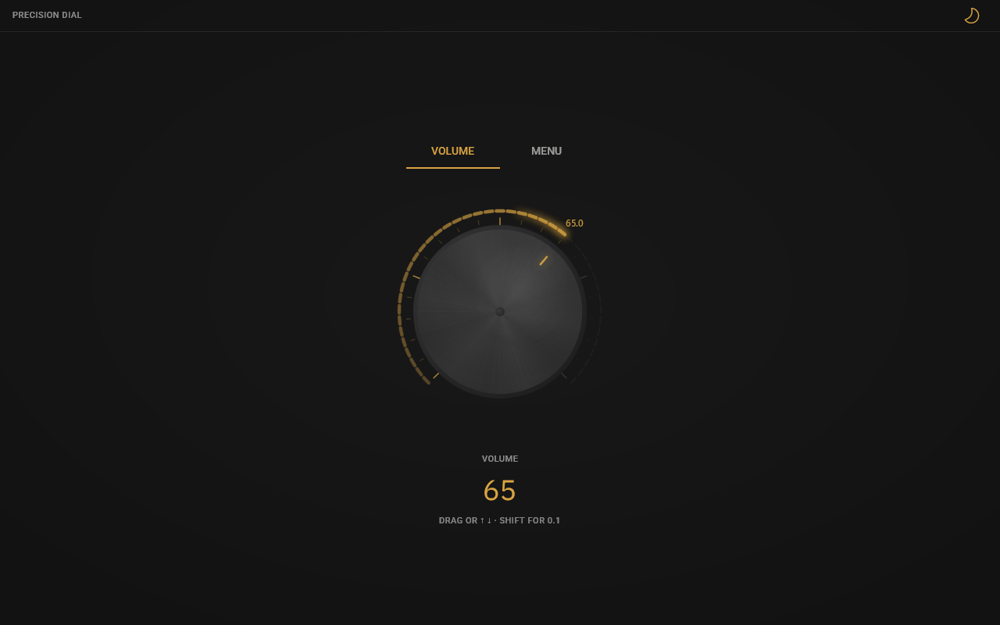
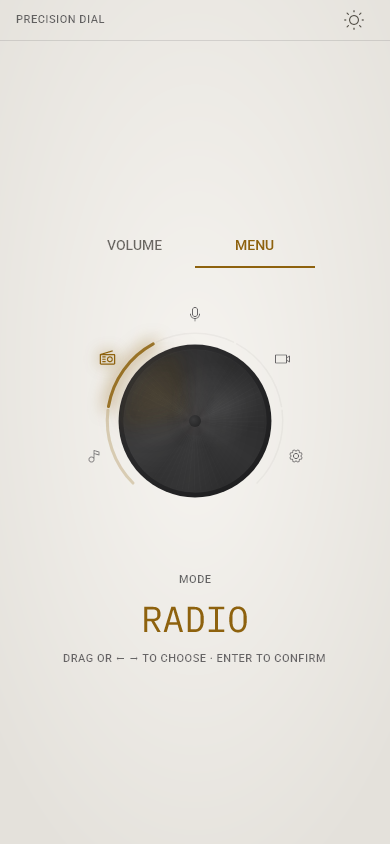

# Precision Dial

- **Owner:** Matthew Mattei (@noknowscode)
- **Status:** ready for review
- **What it is:** `PrecisionDial`, a precision knob control for Uno Platform drawn with SkiaSharp: a brushed-metal knob
  with physics-based rotation, detents with haptic and audio clicks, and two modes on the same control: a volume knob
  (a dashed arc with detent ticks) and a radial menu dial (icons and a cone of light). Keyboard and screen-reader
  support in both modes.



## What it shows

One page with one `PrecisionDial`. A segmented switch (a Toolkit `TabBar` with `TopTabBarStyle`) flips its
`DialMode`:

- **Volume:** `DialMode="Value"`: 0 to 100 with 20 detents, the dashed arc, inertia after a flick. The readout under
  the dial shows the value.
- **Menu:** `DialMode="Menu"`: five items (Music, Radio, Podcast, Video, Settings) with Phosphor icons; the dial snaps
  to an item and the readout shows its label.

Switching back to Volume restores the volume value and range. The sun/moon button in the header switches between
Light and Dark. The same page runs on every head (desktop, WebAssembly, Android).



## Try it

Requirements: the .NET 10 SDK. The Uno.Sdk version is pinned in `global.json` (7.0.22).

```bash
dotnet run --project PrecisionDial/PrecisionDial.csproj -f net10.0-desktop
```

A Debug build waits for the Uno DevServer (Hot Design); from a plain terminal, add `-c Release` or set
`APP_NO_HOTDESIGN=1`.

- **Drag** the dial up and down (hold Shift for 0.1 steps), or around the knob.
- **Keys** (click the dial or Tab to it): Volume: ↑ → / ↓ ← step 1 (0.1 with Shift), PgUp / PgDn ±10, Home / End.
  Menu: ↑ → / ↓ ← next / previous item, Home / End first / last, Enter or Space confirms.

## Using the control

```xml
<controls:PrecisionDial x:Name="Dial" Value="65" Minimum="0" Maximum="100" DetentCount="20" ValueStep="1"
                        Width="300" Height="300"
                        AccentBrush="{ThemeResource PrimaryBrush}"
                        AutomationProperties.Name="Volume" />
```

```csharp
Dial.MenuItems = new List<DialMenuItem>
{
    new() { Label = "MUSIC", Icon = "", Tag = "music" }, // Phosphor glyphs
    new() { Label = "RADIO", Icon = "", Tag = "radio" },
};
Dial.DialMode = DialMode.Menu;                          // or Value; the Value-mode range comes back on switch
Dial.SelectionConfirmed += (s, e) => Play(e.SelectedItem);
```

| Property | Default | Description |
|---|---|---|
| `Value`, `Minimum`, `Maximum` | 0, 0, 100 | The value and its range (Menu mode sets them to the item indexes) |
| `DetentCount` | 20 | Detent steps across the arc (ticks, haptic and audio clicks) |
| `ArcSweepDegrees` | 270 | Sweep of the arc |
| `AccentBrush` | amber | Colour of the lit arc, indicator, value and glow |
| `DialMode` | `Value` | `Value` (volume knob) or `Menu` (radial menu) |
| `MenuItems`, `SelectedIndex`, `SelectedItem` | | Menu mode items (`DialMenuItem`: Label, Icon, Tag) and selection |
| `SegmentCount` | auto | Number of arc segments in value mode (otherwise derived from the size) |
| `Sensitivity` | 0.4 | Drag sensitivity |
| `InteractionMode` | `Auto` | `Auto`, `VerticalOnly` or `AngularOnly` |
| `IsInertiaEnabled`, `InertiaDecayRate` | true, 0.92 | Coasting after a flick |
| `IsHapticEnabled`, `IsAudioEnabled` | true, true | Detent feedback |
| `ArcStyle` | `Dashed` | `Dashed` (segmented arc, orbiting value) or `Continuous` (a ring with 44 ticks) |
| `HotThreshold`, `HotBrush` | NaN, null | Past this value the continuous ring turns `HotBrush` |
| `ValueStep`, `FineStep`, `IsFineMode` | 0, 0.1, false | Drag and key step; fine mode (or Shift) steps by `FineStep` |
| `ShowValueTip` | true | The orbiting value / ring tip |
| `IsInputEnabled` | true | False ignores input and dims the drawing (a Panel has no `IsEnabled`) |

Events: `ValueChanged`, `DetentCrossed`, `DragStarted`, `DragCompleted`, `InertiaCompleted` and `SelectionConfirmed`
(menu mode). `MoveTo(double)` moves the value the way a drag does, with the detent click.

**Keyboard and focus:** the dial is a tab stop with the system focus ring and takes focus on press. Keys as in
*Try it*; a key step that crosses a detent clicks like a drag.

**Automation (`PrecisionDialAutomationPeer`):** in Value mode a slider (`IRangeValueProvider`: value, range, small
change = the key step, large change = a tenth of the range); in Menu mode a spinner (`IValueProvider`: the selected
item's label; setting a label selects that item). Value changes raise the matching property-changed event.

The design brief for the rendering pipeline (dashed arc, orbiting value, radial menu, cone of light, size scaling) is
in [`docs/precision-dial-v3-architecture-brief.md`](docs/precision-dial-v3-architecture-brief.md).

## Design

- **Typeface:** Barlow 400 / 600 for UI text (the Material type ramp, `Styles/MaterialFontsOverride.xaml`), IBM Plex
  Mono for the readout and the continuous ring's digits. All in `PrecisionDial/Assets/Fonts/` with an
  `OFL-<Family>.txt` per family; Phosphor (MIT) for the menu icons.
- **Palette:** `Styles/ColorPaletteOverride.xaml`: Primary is the dial brass (`#D9A441` Dark, `#8E620E` Light),
  Tertiary the copper hot colour. The page passes `PrimaryBrush` as the dial's `AccentBrush`, so editing Primary in
  Uno Platform Studio's Themes tab recolours the dial. The knob stays dark metal in both themes.

## Stack

- Uno Platform single project, Uno.Sdk 7.0.22: desktop, WebAssembly and Android.
- UnoFeatures: Material, Toolkit, Logging, SkiaRenderer, MediaPlayerElement (the detent click plays through
  `MediaPlayer`).
- The knob is an `SKCanvasElement` (Uno.WinUI.Graphics2DSK) drawn by small renderer classes. There is no MVVM
  framework: the page binds the dial with `x:Bind` functions.
- Toolkit: `TabBar` (`TopTabBarStyle`) for the mode switch, `AutoLayout`, `utu:Responsive` for the dial size,
  `SystemThemeHelper` for the theme switch.

## Themes

- The app starts in Dark: `App.xaml.cs` calls `SystemThemeHelper.SetRootTheme(rootFrame, darkMode: true)` once and
  keeps the frame in `App.ThemeRoot`. To follow the system theme instead, remove that call.
- The header switch calls `SystemThemeHelper.SetRootTheme(App.ThemeRoot ?? this, isDark)`: the app's root, or the
  page itself when a host (Uno Platform Studio, the Gallery) shows it without running `App.OnLaunched`.
- `PrecisionDial/Controls/PrecisionDial/Theme/PrecisionDialResources.xaml`: the stage's theme brushes (background,
  labels, hints, divider) in Light and Default, and the font keys. The text brushes reach 4.5:1 on the stage.
- The marks drawn around the knob (detent ticks, unlit arc segments, menu icons) use `DialInk`: white in Dark,
  near-black in Light. The canvas redraws when `ActualThemeChanged` fires.

## Responsive

The dial is 300 px from the Toolkit's Normal width (600 px) and 240 px below it; the switch, dial and readout stay
centred in one column at every width.

## Hot Design previews

In `PrecisionDial/HotDesignPreviews/` (compiled into Debug builds only):

| Preview | Shows |
|---|---|
| `DialCompactPreview` | value mode, 120 px |
| `DialStandardPreview` | value mode, 200 px |
| `DialLargePreview` | value mode, 280 px |
| `DialMenuModePreview` | menu mode with five Phosphor items |

## Project structure

```
PrecisionDial/
  App.xaml(.cs)                 window, Frame, Material theme, Dark at startup, ThemeRoot
  Presentation/MainPage.xaml    header with the theme switch; mode switch, dial and readout
  Controls/PrecisionDial/
    PrecisionDial.cs, PrecisionDial.Properties.cs, PrecisionDialCanvas.cs   the control
    PrecisionDial.Input.cs      keyboard, focus and the automation peer
    Renderers/                  dashed arc, continuous ring, orbiting value, cone of light, menu icons, knurl, metal,
                                caustic, particles
    Physics/, Interaction/      spring, inertia, velocity tracking, angular drag
    Haptics/, Audio/            per-platform haptics, synthesized click
    Scaling/DialSizeProfile.cs  size-dependent geometry and feature thresholds
    Theme/                      stage theme brushes and fonts, DialInk
  HotDesignPreviews/            Hot Design previews (Debug only)
  Assets/Fonts/                 Barlow, Barlow Condensed, IBM Plex Mono (OFL files), Phosphor.ttf (icon font, MIT)
docs/precision-dial-v3-architecture-brief.md
```

## Staging and audit notes

**Verification pass (2026-11-26, latest):** the Android head now builds on Uno Platform 7 with 0 warnings: `Main.Android.cs` and `MainActivity.Android.cs` use the Uno 7 entry point (`Uno.UI.Runtime.Android`, host built in `CreateHost`); on Uno.Sdk 7.0.22 the old one did not compile. Android has not been run on a device or emulator. Desktop, WebAssembly and Android build with 0 warnings. The desktop app was driven through the App MCP on Windows 11 with a GPU: the single-control page was checked in Dark and Light at 1600 and 390 px: keys in both modes, the slider and spinner automation peers, the mode switch restoring the volume range, the Tab order with a visible focus rectangle at every stop, and no MediaPlayer errors in the log. Earlier notes below that say the Android head was not built are superseded.

**Single-control pass (latest):** the sample is now one `PrecisionDial` that switches between a volume knob and a
menu dial. The five tabs (Mixer, Menu, Studio, Audio, Square), the Android bottom-sheet shell and the controls only
they used (`PrecisionDialChannel`, `PrecisionMenuDial`, `PrecisionSquareDial`, `PerimeterLightCanvas`, the readout and
segment-bar helpers) and their previews were removed. Keyboard, focus and the automation peer moved from
`PrecisionDialChannel` into `PrecisionDial` (`PrecisionDial.Input.cs`) and now cover Menu mode too. Switching from Menu
back to Value restores the value range Menu mode overwrites. The `MediaPlayerElement` UnoFeature was added: without it
the detent click logged "The MediaPlayer extension is not installed" and stayed silent on desktop.

**Prototype pass:** the dial was brought in line with the Control Gallery sheet: the continuous ring
(`InstrumentRingRenderer`) with the copper hot range, `PrecisionDialChannel` with its readout, segments, chips, states,
keys and automation peer, the Mixer tab rebuilt as the sheet's panel and phone layout, the sheet's palette and bundled
fonts, and new previews. `IlluminatedReadout` (still used on the Menu and Square tabs) now uses IBM Plex Mono instead
of the Windows-only Courier New. Icon and splash moved to `#D9A441`. Verified: desktop and WebAssembly build with 0
warnings in Release and Debug; the desktop app runs in Dark and Light (switched at runtime) at 390 × 844, 800 × 1000,
1280 × 800 and 1920 × 1080 with no exceptions; ↑ ↑ PgUp, End and Tab were driven with synthesized input (value, MAX
chip, copper, focus ring); the other four tabs still render; each new preview was hosted temporarily in a Debug build
and checked in Dark and Light. Not verified: Android and iOS were not built here, WebAssembly was built but not run,
Hot Design and the Studio import were not opened, and a Shift-drag could not be synthesized headless.

Staged from `noknowscode/uno-lab` (`PrecisionDial/`), then audited (uno-audit) and made ready for review.

**Staging (first pass):** the full Uno template the app was built on (Hosting, Navigation, MVUX, Kiota HTTP,
Configuration, Localization, Serialization, ThemeService, Dsp, a Shell, a Main/Second page pair, appsettings,
`Strings` resources) was removed, since the UI used none of it; `App.xaml.cs` navigates a plain Frame. `AudioMixerModel`
became a plain `INotifyPropertyChanged` class with a DataContext (its bindings had no source). Hard-coded dark colours
moved to theme brushes and the generated purple palette became a hand-kept amber one. `SKPath` mutators (obsolete in
the SkiaSharp that ships with Uno.Sdk 7.0.22) became `SKPathBuilder`, and the WebAssembly trimmer warning in
`PhosphorFont` was fixed. Loose screenshots, `.claude/`, `.run/`, the iOS folder and Windows-only files were left out;
the architecture brief moved to `docs/`.

**Audit and readiness pass:**

- Unreachable pages: `AudioMixerPage` and `SquareVariationsPage` now have tabs (Audio, Square). `LinearSliderPage` and
  `PrecisionSlider` were removed: despite its name and the page's "drag left / right" hint, `PrecisionSlider` was a
  second copy of the square dial (vertical drag, squircle drawn at the height of its 440x110 box), so there was no
  linear slider to show and fixing it would mean writing one.
- Tabs: the tappable `TextBlock`s (not keyboard-reachable) became a Toolkit `TabBar` with `TopTabBarStyle`, each item
  with an `AutomationProperties.Name`.
- Menu dial (`PrecisionMenuDial`): its item labels never showed (each label was created with `Opacity = 0` and nothing
  ever raised it; the icons only showed through a separate opacity line). The labels and icons now follow the row's
  fade. The hosted value dial drew a stray `0.0`; `PrecisionDial` has a new internal `ShowValueLabel` (no public API
  change) that the menu dial turns off. The list colours were a hard-coded amber and 20% white (invisible in Light):
  they now use the dial's `AccentBrush` and `DialInk`, refresh on theme change, and inactive rows sit at 60% opacity.
- Orbiting value: it was drawn at `arcR + 6.5%` of the size, which put it on the canvas edge (the 120 px dial showed
  `5.0` for 25, the 280 px dial `85` for 85.0). It is now clamped inside the canvas. The doubled Studio treble value
  noted during staging does not show any more (checked at 1280, 1920 and 390 px wide).
- Themes: `RequestedTheme="Dark"` removed from `App.xaml`; Dark is applied once at startup through `SystemThemeHelper`
  and a header switch changes it at runtime.
- Responsive: the `AdaptiveTrigger` visual states became `utu:Responsive` values; the Mixer, Audio and Square rows now
  stack below 1080 px (at 800 px the three columns with their segment bars were 2 px too wide).
- Contrast: label, hint and value brushes were 1.5-3.8:1 on the stage; they are now at least 4.6:1 in both themes.
- Cleanup: 67 unused tokens in `PrecisionDialResources.xaml` (the renderers use their own constants), five unused
  `DialSizeProfile` members, `CharacterSpacing` attributes (a no-op on the Skia text stack), the Windows-only
  `Segoe MDL2 Assets` on the arc selector icons (now `SymbolThemeFontFamily`, which Uno bundles), and
  `ApplicationPageBackgroundThemeBrush` on the audio page.
- Debug runs without a DevServer: `UseStudio()` is skipped when `APP_NO_HOTDESIGN=1`.

**Verified here:** desktop and WebAssembly build with 0 warnings in Release and Debug; the previews are left out of
the Release assembly. The desktop app runs every tab in Dark and Light at 1280x800 and 390x844, and Mixer, Menu, Audio,
Square and Studio at 800x1000, Studio at 1920x1080; the theme switch was clicked at runtime; each preview was hosted
temporarily in a Debug build and checked in Dark and Light. No exceptions in the app logs.

**Not verified:** the Android head was not built here, so the Android-only code (`AndroidShellPage`, haptics, the
asset font path) is not checked; WebAssembly was built but not run; the Studio import and Hot Design were not tested;
drag interaction was not exercised (no pointer drags in this environment).

**For review:** the readout's `Courier New` font and the orbiting value's `Segoe UI` typeface are
Windows/macOS fonts; elsewhere they fall back to the platform default. The Menu tab's `IlluminatedReadout`s show the
selected index (1-6) on a 0-100 brightness scale, so they stay mostly unlit.
