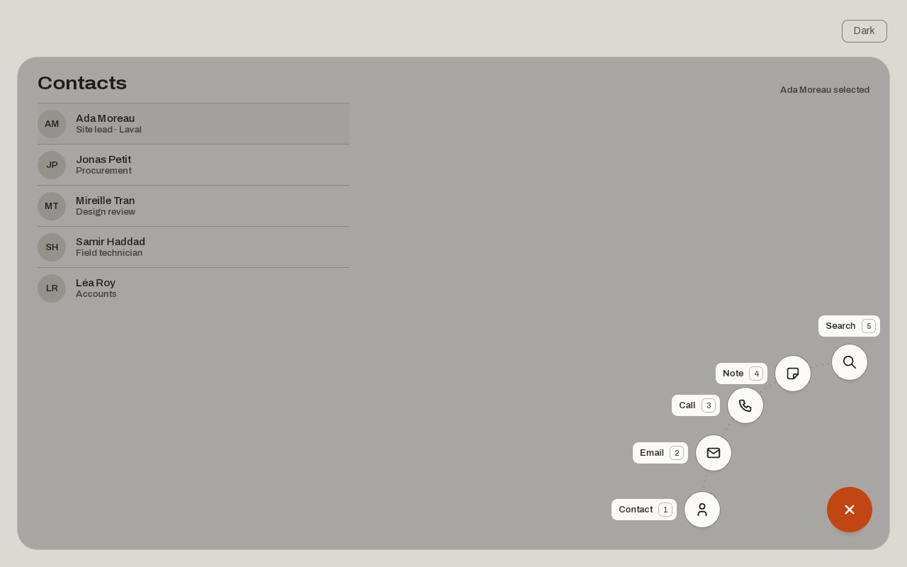
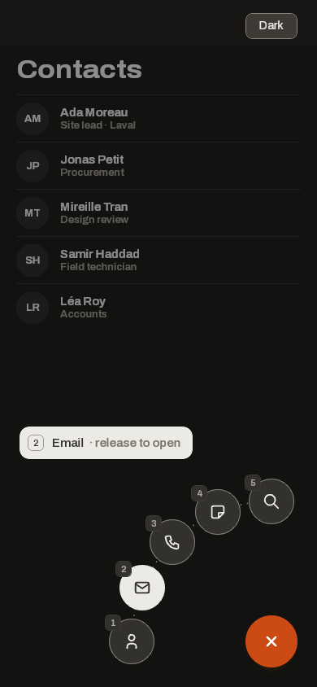

# Radial Action Menu

- **Owner:** Matthew Mattei (@noknowscode)
- **Status:** ready for review
- **What it is:** A floating action button that opens up to five actions on a quarter arc, built to the Control
  Gallery prototype: number keys and arrows on desktop, slide-to-pick with a readout on a phone, labels or key badges,
  a mirrored arc at the left edge and dimmed unavailable actions. The demo is a Contacts panel.



## What it shows

The prototype's Contacts panel with Ada Moreau selected and the menu in the bottom-right corner:

- **Open** with a click, a tap or Space: five discs (Contact, Email, Call, Note, Search) fan out on a 90° arc, 30 ms
  apart, over a scrim with a dotted guide; the plus turns into a close mark. The status line says what you picked.
- **Keyboard:** Tab to the trigger (a "Quick actions · Space" hint shows), Space opens and focuses the first item,
  1-5 pick, the arrows move along the arc, Esc closes; focus returns to the trigger.
- **Phone (below 600 px):** 56 px discs with key badges only. Press the trigger and slide: the disc under your finger
  fills with ink and a readout says "2 Email · release to open"; release to pick.



## Try it

Requirements: the .NET 10 SDK. The Uno.Sdk version is pinned in `global.json` (7.0.22).

```bash
dotnet run --project RadialActionMenuDemo/RadialActionMenuDemo.csproj -f net10.0-desktop
```

Resize the window below 600 px wide for the touch layout. Open `RadialActionMenuDemo.sln` for the WebAssembly and
Android heads.

## Design

From the Control Gallery prototype (sheet 8); what changed and what was left out is in
[`docs/PROTOTYPE-DELTA.md`](docs/PROTOTYPE-DELTA.md).

- **Typeface:** Archivo, bundled in `RadialActionMenuDemo/Assets/Fonts/` under the SIL Open Font License 1.1
  (`OFL-Archivo.txt`). The prototype ships a variable font (weight and width); Skia needs static files, so Regular
  (400), SemiBold (600) and Bold Expanded (700, width 112, the panel title) are static instances cut with fontTools.
  `Styles/MaterialFontsOverride.xaml` sets Archivo as Material's `DefaultFontFamily` and
  `Archivo-Regular.ttf.manifest` maps `FontWeight` to the files. IBM Plex Mono was removed.
- **Palette** (`Styles/ColorPaletteOverride.xaml`): Light is the prototype's: ground #DCD9D2, surface #ECEAE5, chip
  #FBFAF7, ink #252422, muted #55524C, hairline #BDB8AE, disc edge #7F7A70, guide #8E897F, avatar #CFCBC2, accent
  #CC4A14 (Primary), scrim ink at 34%. Dark keeps the warm greys and the accent on #171614. Body text is at least
  5.5:1 in both themes.
- **Sizes:** trigger 64 px, 24 px from both edges; discs 52 px (56 px touch) on a 208 px arc (172 px touch); label
  pill 30 px, 8 px radius, 13 px SemiBold, 10 px from the disc; key badge 20 px, 5 px radius, 11 px; Tabler outline
  icons at 1.75 stroke.
- **Motion:** out 320 ms (`KeySpline 0.2,0.9 0.3,1`) from the trigger at 40% scale, 30 ms apart, fade 160 ms; back
  200 ms (`0.4,0 1,1`), 20 ms apart in reverse, fade 140 ms; scrim 220 ms; guide 200 ms; plus turns 45° in 240 ms.
  With animations turned off in the OS, items only fade (120 ms).

## Stack

- Uno Platform single project, Uno.Sdk 7.0.22: desktop, WebAssembly and Android.
- UnoFeatures: Material, Toolkit, Logging, SkiaRenderer.
- No MVVM or Navigation: a `Frame` in `App.xaml.cs`; the page fills the menu from code-behind.
- The control: `Controls/RadialActionMenu.cs` and `RadialActionMenuItem.cs` (templated controls), their styles and
  tokens in `Controls/RadialActionMenu.xaml`, merged from `App.xaml`.

## Usage

```xml
<Grid>
    <!-- content -->
    <controls:RadialActionMenu x:Name="QuickActions"
                               Position="BottomRight"
                               DiscSize="{utu:Responsive Narrowest=56, Normal=52}"
                               Radius="{utu:Responsive Narrowest=172, Normal=208}"
                               ShowLabels="{utu:Responsive Narrowest=False, Normal=True}"
                               ItemSelected="OnItemSelected" />
</Grid>
```

```csharp
QuickActions.Items = new ObservableCollection<RadialMenuItemData>
{
    new() { Icon = RadialMenuIcons.Contact, Label = "Contact" },
    new() { Icon = RadialMenuIcons.Call, Label = "Call", IsEnabled = false, Command = CallCommand },
};
```

The control fills its container and places the trigger itself; put it in the same `Grid` cell as the content.

### States

| State | How to drive it | Look |
|---|---|---|
| Closed | `IsOpen = false` | `Closed`; items hidden at the trigger, not tab stops |
| Hint | hover or keyboard focus on the trigger, or `IsHintVisible = true` | `HintVisible`: "Quick actions · Space" beside the trigger |
| Opening / closing | set `IsOpen` | staggered storyboards (see Motion), `Opening`/`Opened`/`Closing`/`Closed` events |
| Open | `IsOpen = true` | `Open`; scrim, guide, items with labels (`ShowLabels`) or badges |
| Item focused | arrows, Tab | item `KeyboardFocused`: ring, pill turns ink |
| Touch slide | press the trigger and slide, or `HighlightedIndex` | menu `Sliding` (readout); item `Highlighted` (ink disc) |
| Left edge | `Position = BottomLeft` / `TopLeft` | arc mirrors (0°→90°), labels on the right |
| Unavailable | `RadialMenuItemData.IsEnabled = false` | item `Disabled`: disc 40%, badge 50%; skipped by keys and touch |

### RadialActionMenu

| Member | Type | Default | Description |
|---|---|---|---|
| `Items` | `ObservableCollection<RadialMenuItemData>` | `null` | Up to five actions; collection changes update the menu |
| `Position` | `MenuPosition` | `BottomRight` | `BottomRight`, `BottomLeft`, `TopRight`, `TopLeft`, `Center` |
| `IsOpen` | `bool` | `false` | Opens or closes (animated) |
| `Radius` | `double` | `208` | Trigger centre to disc centres |
| `DiscSize` | `double` | `52` | Disc diameter |
| `TriggerSize` | `double` | `64` | Trigger diameter |
| `EdgeMargin` | `double` | `24` | Trigger distance from both edges |
| `ShowLabels` | `bool` | `true` | Label pills with keys, or key badges only |
| `TriggerLabel` | `string` | `Quick actions` | Hint text and the trigger's automation name |
| `IsHintVisible` | `bool` | `false` | The hint beside the closed trigger |
| `HighlightedIndex` | `int` | `-1` | The item under a sliding finger; `HighlightedLabel`, `HighlightedKey` follow |
| `Open()`, `Close()`, `Toggle()` | methods | | |
| `Opening`, `Opened`, `Closing`, `Closed`, `ItemSelected` | events | | `ItemSelected` passes the `RadialMenuItemData` |

`RadialMenuItemData`: `Icon` (path data on a 24 px grid), `Label`, `Command`, `CommandParameter`, `IsEnabled`.
`RadialActionMenuItem` (created by the menu): `Label`, `KeyLabel`, `IconData`, `DiscSize`, `IconSize`, `Placement`,
`IsHighlighted`, `DiscCenter`.

**API changes in the prototype pass:** `RadialActionMenu` is now a templated `Control` (was a `UserControl`);
added `TriggerSize`, `EdgeMargin`, `DiscSize`, `ShowLabels`, `TriggerLabel`, `IsHintVisible`, `HighlightedIndex`,
`HighlightedLabel`, `HighlightedKey`, `RadialActionMenuItem`, `LabelPlacement`, `RadialMenuIcons`;
`RadialMenuItemData.Glyph` (Segoe code point) became `Icon` (path data) and `IsEnabled` now has a look; `Radius`
default 208 (was 90 and grew with the count); removed `AccentColor` and `IconColor` (use the palette or the
tokens). Tapping the scrim now closes the menu.

### Lightweight styling

In `Controls/RadialActionMenu.xaml`, per theme: `RadialMenuChipBrush`, `RadialMenuChipHoverBrush`,
`RadialMenuGuideBrush`, `RadialMenuScrimBrush`, `RadialMenuTriggerHoverBrush`, `RadialMenuReadoutKeyBrush`; shared:
`RadialMenuDiscShadowBrush`, `RadialMenuTriggerShadowBrush`. The trigger uses `PrimaryBrush`/`OnPrimaryBrush`,
discs `OnSurfaceBrush` and `OutlineBrush`, keys `OnSurfaceVariantBrush` and `OutlineVariantBrush`.

## Themes

The app follows the system theme (the old dark-first start is gone with the CRT look). The **Dark** chip calls
`SystemThemeHelper.SetRootTheme(App.AppRoot, isChecked)`, the hosted-safe Toolkit API; when a host creates the page
without `App.OnLaunched`, the page itself is the root. Everything uses `ThemeResource` brushes and repaints live.

## Responsive

Toolkit `{utu:Responsive}`, default breakpoints. Below Normal (600 px): full-bleed panel, 32 px title, no status
line, and the menu in its touch layout (`DiscSize` 56, `Radius` 172, `ShowLabels` false). Checked at 390×844,
800×1000, 1280×800 and 1920×1080.

## Hot Design previews

`RadialActionMenuDemo/HotDesignPreviews/` (Debug only), one per state, items from `RadialMenuIcons.ContactActions`
through `LoadDataContext`:

| Preview | State |
|---|---|
| `RadialClosedPreview` | Closed |
| `RadialHintPreview` | Closed with the Space hint |
| `RadialOpeningPreview` | Plays the opening (opens 400 ms after load) |
| `RadialOpenPreview` | Open with labels and keys |
| `RadialLeftEdgePreview` | Bottom-left, mirrored arc, badges, Call unavailable |
| `RadialTouchSlidePreview` | Touch layout, Email highlighted with the readout |

## Files

| File | Contents |
|---|---|
| `Controls/RadialActionMenu.cs`, `RadialActionMenuItem.cs` | The controls: layout, motion, keys, touch slide, states |
| `Controls/RadialActionMenu.xaml` | Default styles, templates and tokens |
| `Controls/RadialMenuItemData.cs`, `MenuPosition.cs`, `LabelPlacement.cs`, `RadialMenuIcons.cs` | Model, enums, icons |
| `MainPage.xaml(.cs)` | The Contacts panel, status line, theme switch and menu |
| `Styles/ColorPaletteOverride.xaml`, `MaterialFontsOverride.xaml`, `Typography.xaml` | Palette and type |
| `Assets/Fonts/` | Archivo instances, weight manifest, `OFL-Archivo.txt` |
| `docs/design-brief.md`, `docs/architecture.md` | The original brief and plan (predate both the CRT and the prototype versions) |

## Staging and audit notes

**Verification pass (2026-11-26, latest):** the Android head now builds on Uno Platform 7 with 0 warnings: `Main.Android.cs` and `MainActivity.Android.cs` use the Uno 7 entry point (`Uno.UI.Runtime.Android`, host built in `CreateHost`); on Uno.Sdk 7.0.22 the old one did not compile. Android has not been run on a device or emulator. Desktop, WebAssembly and Android build with 0 warnings. The desktop app was driven through the App MCP on Windows 11 with a GPU: every check in the test plan passed except press-slide-release, which the App MCP cannot drive (no pointer drag). The keys (Space opens and focuses the first item, Up / Down, Esc returns focus to the trigger, 1-5 pick) were sent as real Win32 key messages, because the App MCP's key presses do not reach `PreviewKeyDown`. Earlier notes below that say the Android head was not built are superseded.

Prototype pass (Control Gallery sheet 8): the CRT terminal look, the three demo menus, IBM Plex Mono, the Segoe
glyphs and the elastic spin animation were replaced by the prototype's design (see Design and
`docs/PROTOTYPE-DELTA.md`). The control became a templated `Control` with a separate `RadialActionMenuItem`, its
look in `Controls/RadialActionMenu.xaml`; keys 1-5, arrows, Esc, touch slide-to-pick, the hint, labels or badges,
the left-edge mirror and unavailable items are new; the scrim now closes the menu (the prototype does). Previews redone
one per state. Found on the way: the Toolkit `ShadowContainer` inside the items left stale pixels when an item's focus
look changed (two items looked focused after an arrow key), so the shadows are radial-gradient ellipses.
Verified: desktop and WebAssembly, Release and Debug, 0 warnings; Release desktop at 390×844, 800×1000, 1280×800 and
1920×1080, Light and Dark, with XTest input: click opens and closes, hover and Tab show the hint, Space opens and
focuses Contact, Up/Down move focus (logged: Contact→Email→Call→Email), 2 picks Email and returns focus, Esc closes,
a press-and-slide on the phone highlights Email with the readout and releasing picks it, tapping the scrim closes;
each preview hosted temporarily in Debug in Light and Dark (host removed). Side-by-side with the prototype:
`compare-radial-action-menu.png` in the review scratchpad. Not verified: Android, WebAssembly at runtime, real touch
hardware, screen-reader output, Hot Design itself.

Earlier passes (the CRT version):

Staged from `noknowscode/uno-lab` (`radial-action-menu/`). Changes made for staging:

- Layout: the app project moved from `src/RadialActionMenuDemo/` to `RadialActionMenuDemo/`, with one `global.json`
  (Uno.Sdk 7.0.22; the source had 6.5.33 at the root and 7.0.22 in `src/`) and one set of `Directory.*` files. The
  solution was recreated without the `src` folder.
- Added the WebAssembly head (`Platforms/WebAssembly/`, from the Uno template) and the Logging feature that the
  Debug logging setup in `App.xaml.cs` needs. Removed the Windows packaging leftovers (`Package.appxmanifest`,
  `app.manifest`, publish profiles) and the template's sample `Resources.resw`, since there is no Windows head and no
  localization.
- Theming: the palette had identical dark values under `Light` and `Dark`. It now has a real Light variant and the
  `Default` key for Dark, all 33 roles, with Dark set as the default on the `Application`. The backdrop scrim moved
  from a hard-coded `#C0000000` to a theme brush (40% black in Light).
- Fixed: with five items on a 90° arc at a 90 px radius the square items overlapped; the radius now grows with the
  item count so neighbours stay 6 px apart. Four glyphs pointed at the wrong icons. The open menu raises its z-index
  so its backdrop covers the other menus' triggers.
- App icon and splash screen, solution, and Studio metadata (`uno-sample.json`, `.studiolive/`) were added. The design
  brief and architecture notes moved to `docs/`. Left in the source repo: `radialFAB.mp4`, `radial-action-menu.jsx`
  (the React prototype) and `prompts.md`.

Audit pass (uno-audit), after staging:

- Themes: removed `RequestedTheme="Dark"` from `App.xaml`; Dark is applied once at startup with
  `SystemThemeHelper.SetRootTheme`, and the header has a **DARK** switch that changes the theme live through the
  hosted-safe Toolkit API.
- Responsive: header and content padding and the title size follow `{utu:Responsive}` so the switch fits beside the
  title at phone width.
- Hot Design previews for the control (see above). To make the open previews work, the control replays its open
  animation on `Loaded` when `IsOpen` was set before `Items` arrived.
- Font: the `Consolas, Courier New` override only existed on Windows, and the Material v1 font keys it set no longer
  drive the type scale in Uno Themes 8+. IBM Plex Mono is now bundled (Regular and Medium only, copied from Reticle
  Lab with its `OFL.txt`) and set as `DefaultFontFamily` through `FontOverrideSource`, with a font manifest for the
  Medium weight.
- Fixed: hovering or pressing a trigger or item painted the implicit Filled button's Primary plate over the
  Primary-coloured icon, hiding it. The buttons now use `TextButtonStyle` (a light state overlay) with square corners.
- Keyboard and screen readers: closed items were invisible but still tab stops; they now leave the tab order while
  closed, the trigger comes first in the tree so Tab goes from it to the open items, focus returns to the trigger after
  a pick, and the trigger's automation name switches between "Open actions menu" and "Close actions menu".
- API: `AccentColor` and `IconColor` defaulted to a hard-coded `#1F1F1F` brush that was never applied; they now
  default to `null` (same behaviour, no stray colour). `Items` now listens to `CollectionChanged`. The unused
  `RadialMenuItemData.Icon` was removed. A private `UpdateLayout()` that hid `FrameworkElement.UpdateLayout` was
  renamed `PositionTrigger()`, and `Open`/`Close` no longer keep a second copy of `IsOpen`.
- Hygiene: the ~300 lines of repeated `DoubleAnimation` set-up collapsed into one `Animate` helper (same timings and
  easings); unused usings, global usings and XAML namespaces, narration comments and a wrapper `Grid` were removed;
  the page fills the menus in its constructor instead of on every `Loaded`.

Verified here: desktop Release, WebAssembly Release, desktop Debug and WebAssembly Debug build with 0 warnings, and
the Release assembly contains no preview types. Desktop Release runs at 390×844, 800×1000, 1280×800 and 1920×1080,
driven by real (XTest) clicks and keys: each menu opens, picking Mail or Files updates the panel and closes the menu,
Tab/Space open a menu and reach its items, focus returns to the trigger, and the theme switch goes Dark→Light→Dark
live. The four previews were hosted temporarily in a Debug build and rendered in Light and Dark (the temporary host
was removed). The app logs were clean. Screenshots were retaken. Not verified here: the Android head (no workload in this
environment), WebAssembly at runtime (built, not run), the previews inside Hot Design itself, and import into Uno
Platform Studio.
