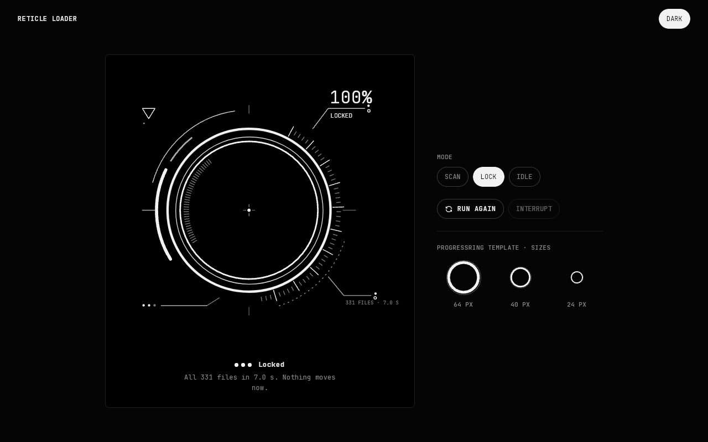

# Reticle Lab

- **Owner:** Matthew Mattei (@noknowscode)
- **Status:** ready for review
- **What it is:** `ReticleLoader`, a HUD-style loader control for Uno Platform with Scanning, Locking, Locked, Idle and
  Interrupted states, plus a keyed `ProgressRing` style that gives the same look at 64, 40 and 24 px. The one-page app
  simulates a workspace sync.



## What it shows

- **The reticle:** two tick bands, three rings, a progress arc on r 104 with a node at its head, an X at the centre,
  corner marks and two leaders. Reading order: percent, phase, telemetry. A status line with three step dots and a
  detail line sits under it.
- **States:** Scanning (bands counter-rotate, an arc sweeps), Locking (bands stop, the arc fills with the percent),
  Locked (the X closes in 480 ms, then nothing moves), Idle (dimmed to 42%), Interrupted (keeps its progress, offers
  Resume).
- **Compact rings:** `ReticleRingCompactStyle` on the stock `ProgressRing`: spinning while indeterminate, the value
  while determinate, the track alone while inactive.
- **The page:** Scan, Lock and Idle pills, Run again (the full sequence: Scan 2.6 s, then Lock in bursts to 100%),
  Interrupt, the three compact rings, and a Light/Dark switch.

## Try it

Requirements: the .NET 10 SDK. The Uno.Sdk version is pinned in `global.json` (7.0.22).

```bash
dotnet run --project ReticleLab/ReticleLab.csproj -f net10.0-desktop
```

The sequence starts on launch. Press Interrupt while it scans or locks, then Resume on the loader. Tab to a pill and
press Space to switch modes. **DARK** top right switches the theme. Open `ReticleLab.sln` for the WebAssembly and
Android heads (`net10.0-browserwasm`, `net10.0-android`).

## Design

From the Control Gallery prototype "Reticle Loader" (the delta is in `docs/PROTOTYPE-DELTA.md`).

- **Typeface:** JetBrains Mono Light, Regular and Medium (static TTFs cut from the prototype's variable font, SIL OFL
  1.1, `ReticleLab/Assets/Fonts/JetBrainsMono/`), applied through the Material font override.
- **Palette (Dark, the prototype's):** ground `#050505`, loader panel `#000000`, ink and accent `#F2F2F2`, muted
  `#8C8C8C`, hairline `#1E1E1E`, control outline `#3C3C3C`. Light inverts the ladder (`#F7F7F7`, `#FFFFFF`, `#111111`,
  `#5E5E5E`). The prototype's optional accents (`#7FD8F2`, `#D4F23F`) are Secondary and Tertiary.
- **Motion:** band A 14 s, band B 9 s reverse, linear; sweep 2.4 s on cubic-bezier(.45,.05,.55,.95); the X closes to
  scale .42 and 45° in 480 ms on cubic-bezier(.3,.7,.2,1); fades 300 ms; status dots pulse 1.2 s staggered 0.2 s.
  Reduced motion (`IsMotionReduced`): Scanning is still and the sweep pulses over 2 s.

## Stack

- Uno Platform single project, Uno.Sdk 7.0.22: desktop, WebAssembly and Android.
- UnoFeatures: Material, Toolkit, Logging, Mvvm, SkiaRenderer.
- CommunityToolkit.Mvvm for `MainViewModel`; a plain `Frame` in `App.xaml.cs`, no Navigation or hosting.

## Usage

```xml
<controls:ReticleLoader State="{x:Bind ViewModel.State, Mode=OneWay}"
                        Value="{x:Bind ViewModel.Progress, Mode=OneWay}"
                        Telemetry="{x:Bind ViewModel.Telemetry, Mode=OneWay}"
                        Detail="{x:Bind ViewModel.Detail, Mode=OneWay}"
                        ResumeCommand="{x:Bind ViewModel.ResumeCommand}"
                        AutomationProperties.Name="Syncing workspace" />

<ProgressRing Style="{StaticResource ReticleRingCompactStyle}" Width="24" Height="24"
              IsActive="True" IsIndeterminate="False" Value="40" />
```

Copy `Controls/ReticleLoader/`, `Themes/ReticleLoader.xaml` and `Themes/ReticleRing.xaml`, and merge both dictionaries
in `App.xaml`. The template uses palette role brushes and the `Mono*FontFamily` keys from
`Styles/MaterialFontsOverride.xaml`.

### ReticleLoader API

| Member | Type | Default | Description |
|---|---|---|---|
| `State` | `ReticleState` | `Scanning` | Scanning, Locking, Locked, Idle or Interrupted |
| `Value` | `double` | `0` | Progress 0–100; drawn while Locking, kept while Interrupted |
| `IsMotionReduced` | `bool` | `false` | Still Scanning with a slow pulse; dots stop pulsing |
| `Telemetry` | `string` | `""` | The small line on the lower-right leader (authored uppercase) |
| `Detail` | `string` | `""` | The muted line under the status |
| `AccentBrush` | `Brush` | `PrimaryBrush` | Sweep, progress arc, node, lock dot, percent |
| `StatusVisibility` | `Visibility` | `Visible` | The status line, detail and Resume under the ring |
| `ResumeCommand` | `ICommand` | `null` | Runs when Resume (Interrupted) is pressed |
| `ResumeRequested` | event | | Raised when Resume is pressed |
| `PercentText`, `PhaseText`, `StatusText` | `string`, read-only | | "—" / "64%", "LOCKING", "Locking · 64%" |

`Foreground` is the ink, `Background` the panel and the node's fill, `BorderBrush`, `CornerRadius` (6) and `Padding`
(24) the frame. The automation peer reports a progress bar; its item status reads like the prototype's value text
("Locking, 64 percent"), and the status line is announced politely.

### States

| State | Visual state | What the template does |
|---|---|---|
| Scanning | `Scanning` / `ScanningReduced` | Bands spin (14 s, 9 s reverse), the sweep turns, percent "—", dots pulse |
| Locking | `Locking` | Bands ease home, the sweep fades, the accent arc and node show the value |
| Locked | `Locked` | The X closes (480 ms), the centre dot turns accent, three dots |
| Idle | `Idle` | The HUD dims to 42% |
| Interrupted | `Interrupted` | The kept arc in ink at 45%, an ink node, "Paused at 64%", Resume |

Every state storyboard animates every animated property with From-less keyframes, so Uno's `VisualStateManager`
hands each one over from its live value (it ignores `GeneratedDuration`). A second group, `StepStates` (Steps0–3),
fills the status dots. Forever animations run only in Scanning.

### Public API changes in this pass

- New `ReticleLoader` control, `ReticleState`, `ReticleLoaderAutomationPeer` and `ReticleArcConverter`.
- Removed `ReticleRingStyle` (the Hero as a ProgressRing restyle): the prototype's Locked and Interrupted states and
  value-driven arc need a control. `ReticleRingCompactStyle` now draws the prototype's compact ring and shows `Value`
  when determinate.
- `MainViewModel` now exposes `State`, `Progress`, `Telemetry`, `Detail` and Scan/Lock/Idle/Interrupt/Resume/RunAgain
  commands (was `Mode`, `IsActive`, `IsIndeterminate`).

## Themes

The app starts in Dark (the design is dark-first): `App.xaml.cs` calls `SystemThemeHelper.SetRootTheme(rootFrame,
darkMode: true)` once. The **DARK** pill calls `SystemThemeHelper.SetRootTheme(App.AppRoot, isChecked)`, which also
works when Studio or the Gallery hosts the page under a XamlRoot the app doesn't own. Every brush is a `ThemeResource`,
so the loader repaints live.

## Responsive

`{utu:Responsive}`: below Normal (600 px) the loader is 358 × 440 with 16 px gutters; from Normal 480 × 560; from
Widest (1080 px) 560 × 640 with the controls beside it instead of below. Checked at 390×844, 800×1000, 1280×800 and
1920×1080.

## Hot Design previews

`ReticleLab/HotDesignPreviews/` (Debug only). One per state, each setting `State` on a `ReticleLoader`:
`ReticleScanningPreview`, `ReticleScanningReducedPreview`, `ReticleLockingPreview` (64%), `ReticleLockedPreview`,
`ReticleIdlePreview`, `ReticleInterruptedPreview` (64%), plus `ReticleCompactRingsPreview` (spinning, 40%, queued).

## Files

| File | Contents |
|---|---|
| `ReticleLab/Controls/ReticleLoader/ReticleLoader.cs` | The control, `ReticleState`, the automation peer |
| `ReticleLab/Controls/ReticleLoader/ReticleArcConverter.cs` | Value → arc geometry for the compact ring |
| `ReticleLab/Themes/ReticleLoader.xaml` | The loader's default style and template, `ReticleOutlineButtonStyle` |
| `ReticleLab/Themes/ReticleRing.xaml` | `ReticleRingCompactStyle` |
| `ReticleLab/Themes/Hud.xaml` | The page's labels, mode pill and theme switch |
| `ReticleLab/Styles/ColorPaletteOverride.xaml`, `MaterialFontsOverride.xaml` | Palette and font override |
| `ReticleLab/Presentation/` | `MainPage` and the simulated sync in `MainViewModel` |
| `docs/PROTOTYPE-DELTA.md` | What this pass took from the prototype, and what it left out |
| `docs/RETICLE-LOADER-SPEC.md` | The original design spec (the 600-unit ProgressRing version, kept for history) |

## Open items

- **Arrow-key group navigation** between the pills: `XYFocusKeyboardNavigation` had no effect; the pills are
  individual tab stops.
- **Reduced motion** reads `UISettings.AnimationsEnabled` once; Uno implements it on Android only (not verified).

## Staging and audit notes

**Verification pass (2026-11-26, latest):** the Android head now builds on Uno Platform 7 with 0 warnings: `Main.Android.cs` and `MainActivity.Android.cs` use the Uno 7 entry point (`Uno.UI.Runtime.Android`, host built in `CreateHost`); on Uno.Sdk 7.0.22 the old one did not compile. Android has not been run on a device or emulator. Desktop, WebAssembly and Android build with 0 warnings. The desktop app was driven through the App MCP on Windows 11 with a GPU: every check in the test plan passed (scan, lock, idle, interrupt and run again, the polite live region on the status); the app's console output was not captured in that run. Earlier notes below that say the Android head was not built are superseded.

Staged from `noknowscode/uno-lab` (`ReticleLab/`): template hosting/Navigation/HTTP removed, a Material palette with
Light and Dark, icon, splash and Studio metadata added, the spec moved to `docs/`. The audit pass added the hosted-safe
theme switch, `{utu:Responsive}` and Hot Design previews.

Prototype pass (this one):

- Replaced the ProgressRing Hero with the `ReticleLoader` control and the prototype's 300-unit geometry (converted from
  its SVG; the old `tools/reticle-geometry.cs` generator was removed with the 600-unit geometry). Added the Locked and
  Interrupted states, the value-driven arc, the status line and reduced motion.
- Restyled the compact ProgressRing to the prototype's ring, with a determinate arc.
- JetBrains Mono replaced IBM Plex Mono (removed with its licence); the palette is the prototype's; the page became a
  minimal host (control, modes, compact sizes, theme switch).

Verified here: desktop and WebAssembly, Release and Debug, build with 0 warnings. The Release desktop app runs with no
exceptions at 390×844, 800×1000, 1280×800 and 1920×1080; the theme switch was clicked at runtime, Interrupt and Resume
were clicked (XTest). Each state preview was hosted temporarily in a Debug build and screenshotted in Light and Dark
(the temporary hook was removed). A side-by-side with the prototype was checked. Not verified here: the Android head
(no workload), WebAssembly at runtime (built, not run), Hot Design itself, the Studio import, animations frame by frame.
