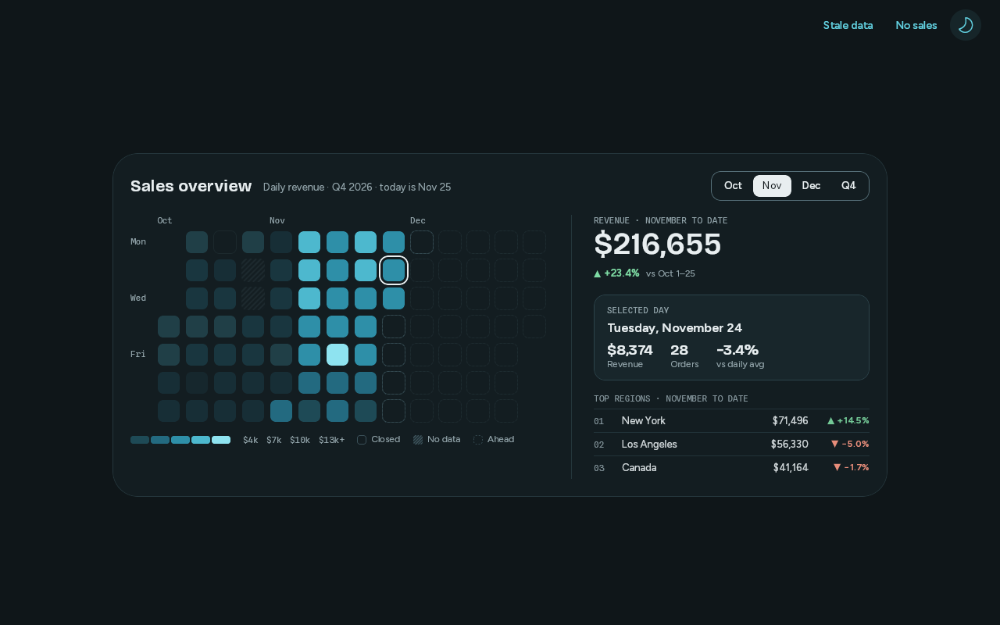

# Sales Heatmap

- **Owner:** Matthew Mattei (@noknowscode)
- **Status:** ready for review
- **What it is:** `SalesHeatmapWidget`, a sales overview control for Uno Platform: a quarter-long daily revenue
  heatmap in five steps of one hue, a period selector, the period's revenue and change, the selected day and the top
  regions, with loading, empty and stale states. An MVUX model feeds it the prototype's Q4 2026 data.



## What it shows

- **The grid:** 14 weeks × 7 days from Sep 28, column-major, month labels on top and Mon / Wed / Fri at the left.
  Five steps at $4k / $7k / $10k / $13k+; closed days outlined, days without data hatched, days after today dashed.
- **Periods:** Oct, Nov, Dec and Q4. Other months dim to 22% but stay in place; the total, its change and the regions
  follow the period.
- **A day:** hover for a tooltip, click to select (an ink ring), or Tab to the grid and use ↑ ↓ (a day) and ← → (a
  week); Esc hides the tooltip. The detail panel shows revenue, orders and the change against the period's daily
  average, and is announced politely.
- **Deltas:** arrow, sign and colour together.
- **States:** Loading, Ready, Empty (no sales in the filter), Stale (the last refresh failed).
- **Phone:** below 860 px of card width the card stacks: title and update time, full-width periods, figures, grid, day,
  regions.

## Try it

Requirements: the .NET 10 SDK. The Uno.Sdk version is pinned in `global.json` (7.0.22).

```bash
dotnet run --project SalesHeatmap/SalesHeatmap.csproj -f net10.0-desktop
```

The overview loads for 1.2 s with Tuesday, November 24 selected. **Stale data** and **No sales** (top right) show the
other states; Retry and Clear filters on the card bring it back. The moon switches the theme. Open `SalesHeatmap.sln`
for the WebAssembly and Android heads.

## Design

From the Control Gallery prototype "Sales Heatmap" (the delta is in `docs/PROTOTYPE-DELTA.md`).

- **Typefaces:** Bricolage Grotesque Medium and SemiBold (titles, figures; cut at opsz 24), Figtree Regular, Medium and
  SemiBold (text), Spline Sans Mono Regular and Medium (labels). Static TTFs cut from the prototype's variable fonts,
  SIL OFL 1.1, in `SalesHeatmap/Assets/Fonts/<Family>/`, applied through the Material font override.
- **Palette (Dark, the prototype's):** page `#0F1619`, card `#131D21`, ink `#E8EEF0`, muted `#93A5AB`, hairline
  `#24363C`, control outline `#567079`, accent `#63D4E4`. Control tokens (`Themes/SalesHeatmap.xaml`, Light and Dark):
  heat ramp `#1E4A56` `#236A80` `#2E8FA8` `#4DB8CE` `#8EE3F0`, hatch `#152024` / `#3A5058`, closed `#3A5058`, ahead
  `#33484F`, hover ring `#8FA3AA`, detail panel `#18262B` / `#2C434A`, banner `#1C2A2F`, skeleton `#1E2C31`, up
  `#7EDCA4`, down `#FF9A85`. Light uses a pale ground with the ramp running pale to dark, so more revenue still reads as more.
- **Motion:** a period change fades cells to and from 22% in 250 ms (ease); everything else switches at once.

## Stack

- Uno Platform single project, Uno.Sdk 7.0.22: desktop, WebAssembly and Android.
- UnoFeatures: Material, Hosting, Toolkit, Logging, MVUX, Navigation, SkiaRenderer.
- **MVUX:** `MainModel` exposes `Snapshot` (`IFeed<SalesSnapshot>`), `Status` and `Filter` (`IState`) and the
  `SimulateStale`, `SimulateEmpty`, `Retry`, `ClearFilters` commands. `MainPage` shows the widget in a `FeedView`: the
  progress template is the widget in Loading, the value template binds `Data` and `Parent.*`.
- **Navigation Extensions:** the shell and its `Main` route, with the Toolkit's extended splash screen.

## Use the control

```xml
<controls:SalesHeatmapWidget Snapshot="{Binding Data}"
                             State="{Binding Parent.Status}"
                             FilterText="{Binding Parent.Filter}"
                             RetryCommand="{Binding Parent.Retry}"
                             ClearFiltersCommand="{Binding Parent.ClearFilters}" />
```

Copy `Controls/SalesHeatmap/` and `Themes/SalesHeatmap.xaml`, merge the dictionary in `App.xaml`, and provide the
`Ui*`, `Display*` and `Mono*FontFamily` keys (see `Styles/MaterialFontsOverride.xaml`).

### API

| Member | Type | Default | Description |
|---|---|---|---|
| `Snapshot` | `SalesSnapshot` | `null` | Days (98 from a Monday), quarter start, today, region shares, per-period comparisons, update time |
| `State` | `SalesHeatmapState` | `Loading` | Loading, Ready, Empty, Stale |
| `PeriodIndex` | `int` | `-1` | 0–2 the quarter's months, 3 the quarter; -1 picks today's month |
| `SelectedDate` | `DateTime?` | `null` | The day in the detail panel; null picks the last day with data before today |
| `Thresholds` | `DoubleCollection` | 4000, 7000, 10000, 13000 | The four steps between the five levels |
| `FilterText` | `string` | `""` | The active filter, shown in the header while Empty |
| `RetryCommand`, `ClearFiltersCommand` | `ICommand` | `null` | Retry (Stale) and Clear filters (Empty) |
| `RetryRequested`, `ClearFiltersRequested` | events | | Raised when those buttons are pressed |
| `Subtitle`, `PeriodTitle`, `TotalText`, `DeltaText`, `DeltaNote`, `SelectedDateText`, `SelectedRevenueText`, `SelectedOrdersText`, `SelectedVsText`, `UpdatedText`, `StaleText`, `RegionsTitle`, `RegionRows`, `ScaleLabels` | read-only | | What the template shows |

Models (`Controls/SalesHeatmap/SalesModels.cs`): `SalesDay` (date, kind, revenue, orders), `SalesDayKind` (Void,
Data, Closed, NoData, Ahead), `SalesRegionShare`, `SalesComparison`, `SalesSnapshot` (with `Q4Sample`, the prototype's
generator: today Nov 25, Oct 12 closed, Oct 20–21 no data). `SalesHeatmapCell` is the day's own templated control.

### States

| State | Visual state | What the card does |
|---|---|---|
| Loading | `Loading` | Every day an outline, "$—", skeleton bars for the change, the date and the regions; nothing changes size |
| Ready | `Ready` | The data |
| Empty | `Empty` | The grid ghosted with "No sales recorded" and Clear filters in place, the filter in the header, figures "—" (never zeros) |
| Stale | `Stale` | A banner "Showing data from 6:40 PM" with Retry above the last good grid, announced politely |

Also `DeltaStates` (DeltaUp, DeltaDown, DeltaNone) and `LayoutStates` (Regular, Compact below
`SalesHeatmapWidget.CompactWidth`, 860 px of card width). Cells: `KindStates` (Void, Level1–5, Closed, NoData, Ahead,
Skeleton), `PeriodStates`, `SelectionStates`, `CommonStates` (hover ring).

### Public API changes in this pass

- `SalesHeatmapWidget` is now a templated `Control` in `SalesHeatmap.Controls` (was a `UserControl` in
  `SalesHeatmap.Presentation`). New: `State`, `PeriodIndex`, `SelectedDate`, `Thresholds`, `FilterText`,
  `RetryCommand`, `ClearFiltersCommand`, the two events and the read-only texts.
- `SalesSnapshot` was replaced: it now carries days, quarter, today, region shares, comparisons and the update time
  (was ten monthly / yearly / region numbers). New types `SalesDay`, `SalesDayKind`, `SalesRegionShare`,
  `SalesComparison`, `SalesHeatmapState`, `SalesRegionRow`, `SalesHeatmapCell`.
- `MainModel.Snapshot` loads once (was a new random snapshot every 2 s); new `Status`, `Filter` and commands.
- `PositiveColor` / `PositiveBrush` left `App.xaml` (now the control's `SalesUpBrush` / `SalesDownBrush`).

## Themes

The app follows the system theme. The moon toggle calls `SystemThemeHelper.SetRootTheme(App.AppRoot, ...)`, which also
works when Studio or the Gallery hosts the page. Every brush in the templates is a `ThemeResource`, so cells, ramp and
deltas recolour live.

## Responsive

The page gives the card 8 px gutters below Normal (600 px) and 32 px from Normal, at most 992 wide. Inside, the card
picks Regular or Compact from its own width (860 px); in Compact the cell pitch fills the width (23 px at 390).
Checked at 390×844, 800×1000 and 1280×800.

## Hot Design previews

`SalesHeatmap/HotDesignPreviews/` (Debug only), one per state on `SalesPreviewData.Sample()`:
`SalesHeatmapLoadingPreview`, `SalesHeatmapReadyPreview`, `SalesHeatmapEmptyPreview`, `SalesHeatmapStalePreview`,
`SalesHeatmapCompactPreview` (390 px), plus `MainPagePreview`.

## Project structure

| Path | What is there |
|---|---|
| `SalesHeatmap/Controls/SalesHeatmap/` | `SalesHeatmapWidget`, `SalesHeatmapCell`, the models |
| `SalesHeatmap/Themes/SalesHeatmap.xaml` | Both default styles and the control's Light/Dark tokens |
| `SalesHeatmap/Presentation/MainModel.cs`, `MainPage.xaml` | The MVUX model and the host |
| `SalesHeatmap/Presentation/Shell.xaml`, `App.xaml.cs` | The shell, the host and the routes |
| `SalesHeatmap/Styles/` | Palette and font override |
| `SalesHeatmap/Assets/Fonts/` | Static TTFs and one `OFL.txt` per family |
| `docs/PROTOTYPE-DELTA.md` | What this pass took from the prototype |

## Staging and audit notes

**Verification pass (2026-11-26, latest):** the Android head now builds on Uno Platform 7 with 0 warnings: `Main.Android.cs` and `MainActivity.Android.cs` use the Uno 7 entry point (`Uno.UI.Runtime.Android`, host built in `CreateHost`); on Uno.Sdk 7.0.22 the old one did not compile. Android has not been run on a device or emulator. Desktop, WebAssembly and Android build with 0 warnings. The desktop app was driven through the App MCP on Windows 11 with a GPU: every check in the test plan passed with the keyboard; clicking a day and the hover tooltip were not re-checked with a pointer, and the bottom grid row at 390 px may be clipped by a few pixels (worth a look by eye). Earlier notes below that say the Android head was not built are superseded.

Staged from `noknowscode/uno-lab` (`sales-heatmap/`). Changes made for staging:

- **Palette.** `ColorPaletteOverride.xaml` was generated by the `Dsp` feature from `ColorPaletteOverride.json` and had
  28 roles, a `Dark` key in place of `Default`, a misspelt `OnsurfaceInverseColor`, and Light inverse colours that were
  copies of the Dark ones. It is now a hand-kept file with all 33 roles in `Light` and `Default`. The brand colours are
  unchanged; the inverse roles were corrected and the missing roles (`ShadowColor`, the four `*Variant*` roles)
  derived from the palette. The `.json` and the `Dsp` feature were removed, so a rebuild cannot regenerate the old file.
- **Page margin on phones.** `utu:SafeArea` sets the page grid's `Padding` to the insets, which replaced the
  `Space300` padding, so the card touched the screen edges at 390 wide. The margin is now on the `FeedView`, and the
  insets are `VisibleBounds` (`All` included `SoftInput`, which SafeArea logged a warning about on a `Grid`).
- **WebAssembly warnings.** `OnLaunched` carries an `IL2026` suppression for `UseNavigation` and `NavigateAsync`, with
  the justification that `LinkerConfig.xml` roots the app assembly (the same pattern as the cargo sample).
- Removed the iOS platform folder (no iOS head in the project), the Windows-only files (`Package.appxmanifest`,
  `app.manifest`, publish profiles), the unused `Strings/` resource file and template placeholder files. Recreated the
  solution with the one project.
- **`docs/` left out.** It held the Studio gallery banners (about 19 MB of renders, captures and their HTML/JS
  tooling), which promote the sample and are not needed to build or understand it. They stay in the source repo.
- Studio metadata (`uno-sample.json`, `.studiolive/`) was regenerated with Uno.Samples URLs, and the screenshots were
  retaken from this build.

Audit pass: contrast fixed, the theme switch, responsive scaling and Hot Design previews added, hygiene.

Prototype pass (this one): the 12 × 8 random grid became the prototype's quarter heatmap with periods, day selection
(pointer and keyboard), tooltip, legend, day detail and regions, as a templated control with Loading, Empty and Stale
states and a compact layout; the prototype's palette and three typefaces; the model now loads the prototype's data once
and can simulate the states. The page is a minimal host. The old Viewbox scaling was dropped (the card lays itself
out).

Verified here: desktop and WebAssembly, Release and Debug, build with 0 warnings. The Release desktop app runs with no
exceptions at 390×844, 800×1000 and 1280×800 in Light and Dark; hover, the Oct and Dec periods, arrow keys, the theme
switch, Stale data and No sales were clicked at runtime (XTest). Each state preview was hosted temporarily in a Debug
build and screenshotted in Light and Dark (the hook was removed). A side-by-side with the prototype was checked. Not
verified: Android and iOS (not built here), the WebAssembly build at runtime, Hot Design and the Studio import. There
are no tests.
