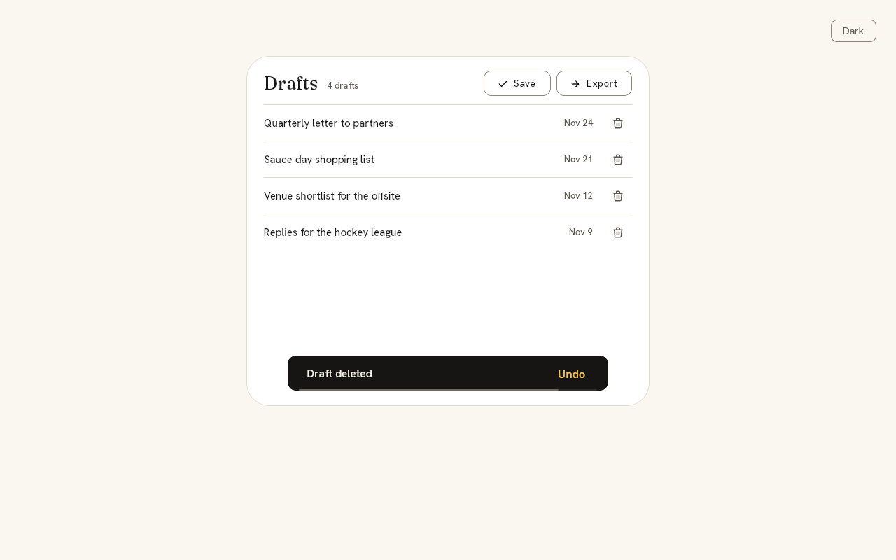
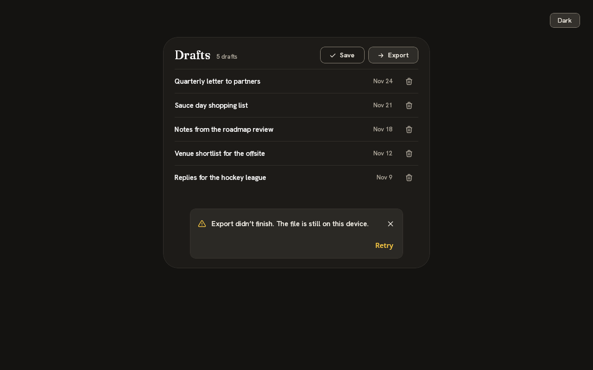

# Snackbar

- **Owner:** Matthew Mattei (@noknowscode)
- **Status:** ready for review
- **What it is:** A `Snackbar` and `SnackbarHost` for Uno Platform, proposed for the Uno Toolkit and built to the
  Control Gallery prototype: Confirm, Undo and Attention messages docked at the bottom of the content, a countdown
  track that pauses on hover, focus or touch, and a replace hand-off so messages never stack.



## What it shows

The prototype's Drafts list, wrapped in a `SnackbarHost`:

- **Delete** a draft (trash button): an **Undo** message (7 s, one action). Undo puts the draft back and confirms.
- **Save**: a **Confirm** message (4 s, no action).
- **Export**: an **Attention** message (stays until closed, warning icon, close button, Retry below).
- On a phone (below 600 px) the list fills the screen, the toolbar is icon-only and an add button sits above the
  docked snackbar.

Point at a message, tab into it or hold a finger on it and the countdown track stops; it resumes when you leave.
A new message replaces the one on screen after its 160 ms exit. The **Dark** chip top right switches the theme.



## Try it

Requirements: the .NET 10 SDK. The Uno.Sdk version is pinned in `global.json` (7.0.22).

```bash
dotnet run --project SnackbarDemo/SnackbarDemo.csproj -f net10.0-desktop
```

Delete a draft and press Undo, or press Save or Export. Press Escape while a message has focus, or swipe it sideways,
to close it. Open `Snackbar.sln` in Visual Studio or Rider for the WebAssembly and Android heads.

## Design

From the Control Gallery prototype (sheet 7); what changed and what was left out is in
[`docs/PROTOTYPE-DELTA.md`](docs/PROTOTYPE-DELTA.md).

- **Typeface:** Hanken Grotesk (UI and message, 400/500/600) and Fraunces (list title, 500), bundled in
  `SnackbarDemo/Assets/Fonts/` under the SIL Open Font License 1.1 (`OFL-HankenGrotesk.txt`, `OFL-Fraunces.txt`).
  The prototype ships variable fonts; Skia needs static files, so each weight is a static instance cut with fontTools
  (Fraunces at optical size 36). `Styles/MaterialFontsOverride.xaml` sets Hanken Grotesk as Material's
  `DefaultFontFamily` and `HankenGrotesk-Regular.ttf.manifest` maps `FontWeight` to the three files.
- **Palette** (`Styles/ColorPaletteOverride.xaml`): Light is the prototype's: paper #FAF7F0, surface #FFFFFF, ink
  #161514, muted #5E5A52, hairline #E2DCCF, outline #8C8578. The slip is the inverse surface (#161514) with #F6F2EA
  text and a #F5C542 action (`PrimaryInverse`); the close icon (#A9A296) and the track (#2E2C29 / #6E685E) are
  control tokens. Dark keeps the identity on #141311: the slip is lifted to #2B2925 with a hairline, the action
  stays gold. Body text is at least 6.4:1 in both themes.
- **Shape:** 12 px radius, 52 px row (60 px on a phone), 460 px max width, docked 20 px from the edges; 36 px round
  action and close buttons; a 2 px track inset 16 px; Tabler outline icons at 1.75 stroke.
- **Motion:** 220 ms rise in (opacity and 12 px, `KeySpline 0.2,0.8 0.2,1`), 160 ms fade out (`0.25,0.1 0.25,1`),
  press scale .96, a linear drain over the message's duration.

## Stack

- Uno Platform single project, Uno.Sdk 7.0.22: desktop, WebAssembly and Android.
- UnoFeatures: Material, Toolkit, SkiaRenderer.
- The control lives in `SnackbarDemo/Controls/Snackbar/` in the `Uno.Toolkit.UI` namespace. Its template and tokens
  are in `Snackbar.xaml` and `SnackbarHost.xaml`; `Styles/Controls/Snackbar.xaml` adds the keyed Material styles and
  implicit styles. All are merged from `App.xaml`.

## Usage

Merge `Controls/Snackbar/Snackbar.xaml`, `Controls/Snackbar/SnackbarHost.xaml` and `Styles/Controls/Snackbar.xaml`
(in that order, after `MaterialToolkitTheme`), then wrap the content in a `SnackbarHost`.

```xml
<utu:SnackbarHost x:Name="SnackbarHost">
    <!-- content -->
</utu:SnackbarHost>
```

```csharp
var reason = await SnackbarHost.ShowAsync(new SnackbarItem
{
    Kind = SnackbarKind.Undo,
    Message = "Draft deleted",
    ActionLabel = "Undo",
});
if (reason == SnackbarDismissReason.Action) { /* restore */ }

await SnackbarHost.ShowAsync(new SnackbarItem { Kind = SnackbarKind.Confirm, Message = "All changes saved" });

await SnackbarHost.ShowAsync(new SnackbarItem
{
    Kind = SnackbarKind.Attention,
    Message = "Export didn’t finish. The file is still on this device.",
    ActionLabel = "Retry",
});
```

### States

| State | How to drive it | Look (visual state) |
|---|---|---|
| Confirm | `Kind = Confirm` (4 s) | no action; `Timed` track |
| Undo | `Kind = Undo` (7 s) + `ActionLabel` | `WithAction` inline; `Timed` track |
| Attention | `Kind = Attention` (stays) | `AttentionIcon`, `WithDismiss`, `MultiLine`, `WithActionOnNewLine`; `Untimed` |
| Long message | `Message` longer than `MultiLineThreshold` (44), or `IsActionOnNewLine` | `MultiLine`: wraps at 370 px, action below |
| Held | hover, keyboard focus or touch; or set `IsHeld = true` | `Held`: countdown and track stop; `Running` on release |
| Part-drained | `Progress` (0-1) | track scaled to the share left |
| Replace | `ShowAsync` while one is showing | host `IsReplacing = true`, `Replacing`: the current one fades out (160 ms), then the next rises |

### Snackbar

| Member | Type | Default | Description |
|---|---|---|---|
| `Message` | `string` | `""` | The text |
| `Kind` | `SnackbarKind` | `Confirm` | Confirm, Undo or Attention |
| `ActionLabel` | `string` | `null` | The action button; none when empty |
| `ActionCommand`, `ActionCommandParameter` | `ICommand`, `object` | | Run on the action |
| `ShowDismissButton` | `bool` | `false` | Close button (Attention always has one) |
| `IsActionOnNewLine` | `bool` | `false` | Forces the two-row layout |
| `MultiLineThreshold` | `int` | `44` | Message length that switches to two rows |
| `Icon` | `object` | `null` | Content in a 24×24 box before the message; Attention defaults to a warning sign |
| `Duration` | `TimeSpan?` | `null` | Countdown length; null = the kind's default |
| `Progress` | `double` | `1` | Share of the duration left; the countdown starts from it |
| `IsHeld` | `bool` | `false` | Countdown paused (hover, focus, touch, or the app) |
| `EffectiveDuration`, `IsMultiLine` | read-only | | The duration and layout in effect |
| `StartCountdown()`, `StopCountdown()` | methods | | The host calls them; usable standalone |
| `ActionClicked`, `DismissClicked`, `Expired` | events | | Action, close or Escape, countdown done |

### SnackbarHost

| Member | Type | Default | Description |
|---|---|---|---|
| `ShowAsync(SnackbarItem)` | `Task<SnackbarDismissReason>` | | Shows a message, completes when it closes |
| `ShowAsync(message, actionLabel?, actionCommand?, duration?, kind?)` | `Task<SnackbarDismissReason>` | | Shorthand; kind defaults to Undo with an action, Confirm without |
| `Dismiss()` | `void` | | Closes the current message |
| `SnackbarStyle` | `Style` | `null` | Style for each `Snackbar` the host creates |
| `IsSwipeToDismissEnabled` | `bool` | `true` | Horizontal swipe closes the message |
| `MaxQueueSize` | `int` | `5` | Pending messages kept; the oldest is dropped with `Replaced` |
| `IsShowing`, `IsReplacing` | `bool` | `false` | A message is on screen; a replace hand-off is running |
| `SnackbarHost.Host` (attached) | `SnackbarHost` | | Lets any element reach a host |
| `SnackbarOpened`, `SnackbarClosed` | `EventHandler<SnackbarItem>` | | After the enter and exit animations |

`SnackbarItem` carries `Message`, `Kind`, `ActionLabel`, `ActionCommand`, `ActionCommandParameter`,
`ShowDismissButton`, `IsActionOnNewLine`, `Icon` and `Duration`. `SnackbarDuration` has `Short` (4 s), `Long` (7 s),
`Indefinite` and `For(kind)`.

**API changes in the prototype pass:** added `SnackbarKind`, `Snackbar.Kind`, `Icon`, `Duration`, `Progress`,
`IsHeld`, `MultiLineThreshold`, `EffectiveDuration`, `IsMultiLine`, `StartCountdown`, `StopCountdown`, `Expired`,
`SnackbarItem.Kind`/`Icon`, `SnackbarHost.IsReplacing`, `SnackbarDuration.For`, a `kind` parameter on the shorthand
`ShowAsync`. Removed `SnackbarHost.DefaultDuration` (the kind sets the default) and the `PART_ActionButtonMultiLine`
/ `PART_DismissButtonMultiLine` template parts (one action button moves between rows). The message is announced
politely instead of assertively.

### Lightweight styling

In `Controls/Snackbar/Snackbar.xaml`. Per theme: `SnackbarBackground`, `SnackbarMessageForeground`,
`SnackbarActionForeground` (aliases of `SurfaceInverseBrush`, `OnSurfaceInverseBrush`, `PrimaryInverseBrush`),
`SnackbarDismissForeground`, `SnackbarTrackBackground`, `SnackbarTrackForeground`, `SnackbarBorderBrush`. Shared:
`SnackbarCornerRadius`, `SnackbarPadding`, `SnackbarMultiLinePadding`, `SnackbarMaxWidth`, `SnackbarMessageFontSize`,
`SnackbarMessageLineHeight`, `SnackbarMessageMaxWidth`, `SnackbarActionFontSize`, `SnackbarButtonSize`,
`SnackbarIconSize`, `SnackbarTrackHeight`, `SnackbarTrackMargin`, and `SnackbarHostMargin` in `SnackbarHost.xaml`.

[`docs/Snackbar.md`](docs/Snackbar.md) and [`docs/snackbar-component-plan.md`](docs/snackbar-component-plan.md)
describe the earlier Material 3 version and the original plan.

## Themes

The app follows the system theme at startup. The **Dark** chip (a Toolkit `Chip` with `FilterChipStyle`) calls
`SystemThemeHelper.SetRootTheme(App.AppRoot, isChecked)`, the hosted-safe API for Studio and the Gallery; when a host
creates the page without `App.OnLaunched`, the page itself is the root. Snackbar colours are `ThemeResource` tokens,
so a message on screen repaints with the page.

## Responsive

Toolkit `{utu:Responsive}`, default breakpoints. Below Normal (600 px): the list card is full-bleed, rows are 60 px,
the title is 32 px, the toolbar buttons are icon-only and the add button shows. The snackbar's row grows from 52 to
60 px through `utu:Responsive` in its template, and it stretches to the width minus 20 px margins. Checked at 390×844,
800×1000, 1280×800 and 1920×1080.

## Hot Design previews

`SnackbarDemo/HotDesignPreviews/` (Debug only), one per state:

| Preview | Control | State |
|---|---|---|
| `SnackbarConfirmPreview` | `Snackbar` | Confirm, track 60% left |
| `SnackbarUndoPreview` | `Snackbar` | Undo with action, track 35% left |
| `SnackbarAttentionPreview` | `Snackbar` | Attention: icon, close, Retry below |
| `SnackbarLongMessagePreview` | `Snackbar` | Long message with a custom wifi-off icon, wrapped, action below |
| `SnackbarHeldPreview` | `Snackbar` | Held (`IsHeld`), paused at 55% |
| `SnackbarReplacePreview` | `SnackbarHost` | Shows an Undo, then a Confirm that replaces it |

## Project structure

```
SnackbarDemo/
  Controls/Snackbar/
    Snackbar.cs, Snackbar.Properties.cs   states, countdown, hold, announcements, automation peer
    Snackbar.xaml                         template and tokens
    SnackbarHost.cs, .Properties.cs       ShowAsync, replace hand-off, motion, swipe
    SnackbarHost.xaml                     host template
    SnackbarItem.cs, SnackbarKind.cs, SnackbarDuration.cs, SnackbarDismissReason.cs
  Helpers/DispatcherCompat.cs             stand-in for the Toolkit's internal helper
  Styles/Controls/Snackbar.xaml           keyed and implicit Material styles
  Styles/ColorPaletteOverride.xaml, MaterialFontsOverride.xaml, Typography.xaml
  Assets/Fonts/                           Hanken Grotesk, Fraunces, weight manifest, OFL licences
  HotDesignPreviews/                      one preview per state (Debug only)
  MainPage.xaml(.cs)                      the Drafts demo
```

## Staging and audit notes

**Verification pass (2026-11-26, latest):** the Android head now builds on Uno Platform 7 with 0 warnings: `Main.Android.cs` and `MainActivity.Android.cs` use the Uno 7 entry point (`Uno.UI.Runtime.Android`, host built in `CreateHost`); on Uno.Sdk 7.0.22 the old one did not compile. Android has not been run on a device or emulator. Desktop, WebAssembly and Android build with 0 warnings. The desktop app was driven through the App MCP on Windows 11 with a GPU: every check in the test plan passed, after one fix in this pass: at 390 px the two-line Attention message covered the add (+) button, which now stays 16 px above a message of any height (`SnackbarHost.OccupiedHeight`). Earlier notes below that say the Android head was not built are superseded.

Prototype pass (Control Gallery sheet 7): the control now carries the prototype's design, kinds, countdown, hold and
replace states (see Design, States and `docs/PROTOTYPE-DELTA.md`); the demo page became the prototype's Drafts list;
fonts and palette replaced; previews redone one per state; the open question below is settled by the prototype
(replace, never stack). Verified: desktop and WebAssembly, Release and Debug, 0 warnings; Release desktop at 1280×800
and 390×844 in Light and Dark with XTest clicks: delete shows Undo with a draining track, pointing at it held the
track for 4 s, Export replaced it after the exit (Attention, icon, close, Retry below), Save showed Confirm and it
timed out, the Dark chip switched live; each preview was hosted temporarily in a Debug build and rendered in Light
and Dark (host removed). Side-by-side with the prototype: `compare-snackbar.png` in the review scratchpad. Not
verified: Android, WebAssembly at runtime, touch hold and swipe, screen-reader output, Hot Design itself.

Earlier passes:

Staged from `noknowscode/uno-lab` (`SnackBar/`), which is laid out like an Uno Toolkit fork. The staged sample is the
standalone test app (`testapp/SnackbarTestApp`, renamed `SnackbarDemo`), which already carried its own copy of the
control source under `Controls/Snackbar/` (identical to `src/Uno.Toolkit.UI/Controls/Snackbar/`) and no project
reference into `src/`. Left in the source repo: the runtime tests (`src/Uno.Toolkit.RuntimeTests/Tests/SnackbarTests.cs`,
which need the Toolkit's test harness), the Toolkit samples-app page (`samples/Uno.Toolkit.Samples/.../SnackbarSamplePage`),
the Cupertino style (`src/library/Uno.Toolkit.Cupertino/...`) and `snackbar-mockup.html`. `doc/controls/Snackbar.md`
and `snackbar-component-plan.md` moved to `docs/`.

Changes made for staging:

- The test app's Material style used hard-coded hex colours, because the Toolkit fork's Material style
  (`src/library/Uno.Toolkit.Material/Styles/Controls/v2/Snackbar.xaml`) aliases `InverseSurfaceBrush`,
  `InverseOnSurfaceBrush` and `InversePrimaryBrush`, which do not exist in Uno Material. The keys are
  `SurfaceInverseBrush`, `OnSurfaceInverseBrush` and `PrimaryInverseBrush`. `Styles/Controls/Snackbar.xaml` is now the
  fork's Material style with those three names corrected, so the snackbar follows the palette in Light and Dark. The
  docs use the corrected names too.
- The palette now sets all 33 Material roles in Light and Default (Dark), keeping the test app's colours (primary
  #5946D2).
- Added the Android head, app icon, splash screen, solution and Studio metadata (`uno-sample.json`, `.studiolive/`).
  Removed Windows publish profiles, the appx and app manifests, template read-mes, the unused `Strings/` resource and
  the template PWA manifest (named "TempWasm"). Fixed the WebAssembly linker config, which named "TempWasm" as the app
  assembly.
- The page title reads "Snackbar" instead of "Snackbar Test App".

Audit pass (uno-audit), after staging:

- Implicit styles: a `SnackbarHost` without a `Style` rendered nothing. `Styles/Controls/Snackbar.xaml` now ends with
  implicit `Snackbar` and `SnackbarHost` styles based on the Material ones (the keyed styles stay), and the demo page
  relies on them.
- Fixed: the action and close buttons picked up the implicit Material filled-button style, so hovering painted a solid
  Primary plate over the inverse surface. They now use `MaterialSnackbarButtonStyle` (M3 state layer).
- Fixed: a `ShowAsync` call made during the 150 ms enter animation waited in the queue until the current message timed
  out, while one made a moment later replaced it. Queued messages are now processed when the enter animation ends,
  so both cases replace. The demo's "Queue 3 Messages" button therefore replaces too and is now labelled "Show 3 in a
  Row (Each Replaces)". (The original plan described this demo as sequential; see open question below.)
- Fixed: `SnackbarHost` stopped showing messages after being unloaded and loaded again (re-parenting), because
  `Unloaded` cleared its ready flag and only `OnApplyTemplate` set it. `Loaded` now restores it. The action command's
  `CanExecute` is checked before `Execute`.
- Contrast: Light `OnSurfaceVariant` was `#8B8494` (3.5:1 on the background); it is now `#5E5966` (6.6:1).
- Themes: a **Dark** chip switches the theme at runtime through the hosted-safe Toolkit API; the app still follows the
  system theme at startup.
- Responsive: padding follows `{utu:Responsive}`.
- Hot Design previews for each snackbar variant and the host (see above).
- Hygiene: the template's commented-out font override and placeholder comments in `App.xaml`, unused global usings,
  narration comments and an unused task variable in the queue demo were removed.

Settled by the prototype pass (replace, never stack); the earlier question was: should a burst of `ShowAsync` calls replace (the behaviour now, matching
`SnackbarDismissReason.Replaced` and Android's snackbar) or queue one after another (what the plan's "Queue 3
Messages" demo described)? The fix makes the behaviour consistent either way; switching to sequential is a small
change in `ProcessQueue`.

Verified here: desktop Release, WebAssembly Release, desktop Debug and WebAssembly Debug build with 0 warnings, and the
Release assembly contains no preview types. Desktop Release runs at 390×844, 800×1000, 1280×800 and 1920×1080 in Light
and Dark, driven by real (XTest) clicks: Basic times out (`Timeout`), Retry closes with `Action`, the close button with
`Dismiss`, the 3-in-a-row demo ends on "Message 3 of 3", hover shows the state layer, and the Dark chip switches
Light→Dark→Light live. The five previews were hosted temporarily in a Debug build and rendered in Light and Dark (the
temporary host was removed). App logs had no exceptions. Screenshots were retaken. Not verified here: the Android head
(no workload in this environment), WebAssembly at runtime (built, not run), swipe and Escape (not driven here), the
previews inside Hot Design itself, and import into Uno Platform Studio.
